# Manual Técnico – Infraestructura Financiera y Alta Disponibilidad BanTech GT

**Universidad de San Carlos de Guatemala – Facultad de Ingeniería**
**Escuela de Ciencias y Sistemas – Redes de Computadoras 1**
**Proyecto 2 – Segundo Semestre 2026 – Grupo 2**

| Rol | Nombre | Carnet | Responsabilidad |
|-----|--------|--------|-----------------|
| Coordinador | Fabio Josué Hernández Martinez | 201801005 | Backbone, integración y pruebas globales |
| Integrante | Santiago Julián Barrera Reyes | 201905884 | Sede Occidente y Data Center |
| Integrante | José Javier Quan García  | 202001952 | Sede Norte y Sede Oriente |

---

## Índice

1. [Descripción general](#1-descripción-general)
2. [Parámetros del grupo](#2-parámetros-del-grupo)
3. [Topología general](#3-topología-general)
4. [Backbone Core](#4-backbone-core)
5. [Tabla de VLANs](#5-tabla-de-vlans)
6. [Direccionamiento IP (VLSM)](#6-direccionamiento-ip-vlsm)
7. [Inventario de equipos](#7-inventario-de-equipos)
8. [Sedes](#8-sedes)
9. [Pruebas de convergencia](#9-pruebas-de-convergencia)
10. [Pruebas de alta disponibilidad](#10-pruebas-de-alta-disponibilidad)
11. [Conclusiones y mejoras](#11-conclusiones-y-mejoras)

---

## 1. Descripción general

BanTech GT es una entidad financiera en expansión cuya operación depende de transacciones en tiempo real. La red se divide en dos dominios:

- **Backbone Core:** núcleo transaccional redundante que interconecta las sedes y sirve de puente de redistribución entre los distintos protocolos de enrutamiento.
- **Redes de borde:** cuatro sedes (Occidente, Norte, Oriente y Data Center/Sede Central), cada una diseñada según su necesidad operativa.

La simulación completa se encuentra en `BanTech_Grupo2.pkt` (Cisco Packet Tracer 9.0.1). Las configuraciones de cada equipo están en la carpeta `configs/`.

## 2. Parámetros del grupo

| Parámetro | Valor | Origen |
|-----------|-------|--------|
| XX | 05 | Últimos dos dígitos del carnet del coordinador (201801005) |
| Y | 2 | Último dígito del número de grupo |
| Dominio VTP | `bantech05` | `bantechXX` |
| Password VTP | `cisco` | Enunciado |
| Red base | 10.5.0.0/16 | Propuesta del grupo, segundo octeto = XX |

## 3. Topología general

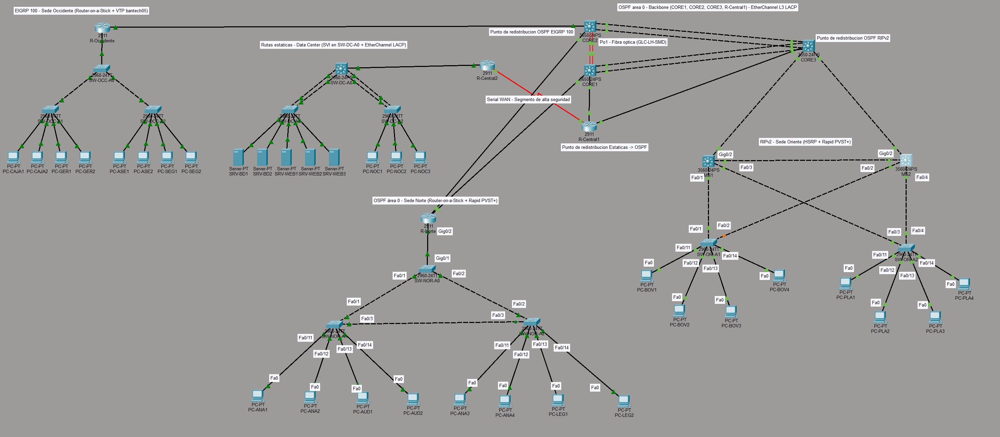

Las notas sobre el diagrama identifican el dominio de enrutamiento de cada área (OSPF, EIGRP, RIPv2 y rutas estáticas), los tres puntos de redistribución, el enlace de fibra óptica y el enlace serial WAN.

### Dominios de enrutamiento

| Dominio | Área | Función dentro de la arquitectura |
|---------|------|-----------------------------------|
| OSPF área 0 | CORE1, CORE2, CORE3, R-Central1 y Sede Norte | Dominio principal del núcleo transaccional |
| EIGRP 100 | Sede Occidente (R-Occidente) | Dominio de expansión regional |
| RIPv2 | Sede Oriente (MS1 y MS2) | Dominio de red legada del banco adquirido |
| Rutas estáticas | Data Center y Sede Central (R-Central2, SW-DC-A0) | Segmento de alta seguridad |

---

## 4. Backbone Core

### 4.1 Diseño

- **Cantidad de dispositivos:** tres switches multicapa Catalyst 3650-24PS (CORE1, CORE2 y CORE3) más dos routers ISR 2911 de la Sede Central (R-Central1 y R-Central2).
- **Forma de interconexión:** los tres núcleos forman un triángulo; cada lado es un EtherChannel de capa 3 con LACP de dos enlaces.
- **Puntos de redistribución:** CORE2 (OSPF ↔ EIGRP), CORE3 (OSPF ↔ RIPv2) y R-Central1 (estáticas → OSPF).

| Enlace | Interfaces | Medio | Agregación |
|--------|-----------|-------|------------|
| CORE1 ↔ CORE2 | Gi1/1/1-2 (módulos SFP GLC-LH-SMD) | Fibra óptica | Po1, LACP |
| CORE1 ↔ CORE3 | Gi1/0/1-2 | Ethernet (cobre) | Po2, LACP |
| CORE2 ↔ CORE3 | Gi1/0/3-4 | Ethernet (cobre) | Po3, LACP |
| CORE1 ↔ R-Central1 | Gi1/0/14 ↔ Gi0/0 | Ethernet | – |
| CORE3 ↔ R-Central1 | Gi1/0/14 ↔ Gi0/1 | Ethernet | – |
| R-Central1 ↔ R-Central2 | Se0/0/0 ↔ Se0/0/0 (HWIC-2T) | Serial WAN | – |
| CORE1 / CORE2 ↔ R-Norte | Gi1/0/10 ↔ Gi0/0 y Gi0/1 | Ethernet | – |
| CORE2 ↔ R-Occidente | Gi1/0/11 ↔ Gi0/0 | Ethernet | – |
| CORE3 ↔ MS1 / MS2 | Gi1/0/12 y Gi1/0/13 ↔ Gi0/1 | Ethernet | – |
| R-Central2 ↔ SW-DC-A0 | Gi0/0 ↔ Gi0/1 | Ethernet | – |

### 4.2 Justificación

El núcleo se construyó con tres switches de capa 3 en triángulo para eliminar el punto único de falla: si cualquiera de los tres núcleos o cualquiera de sus enlaces cae, los otros dos mantienen la conectividad y OSPF recalcula la ruta en segundos (ver sección 10.1). La agregación de enlaces se implementó con LACP (IEEE 802.3ad) porque es un estándar abierto y porque cada Port-channel suma el ancho de banda de sus miembros y tolera la caída de un cable sin que OSPF pierda la adyacencia. El canal CORE1 ↔ CORE2 es el principal transporte del tráfico transaccional, por eso se construyó sobre fibra óptica, que ofrece inmunidad a interferencia electromagnética y mayor alcance.

Cada dominio externo tiene un único punto de redistribución. Esto evita los bucles de enrutamiento y las rutas subóptimas que aparecen cuando dos routers redistribuyen de forma mutua el mismo dominio. La Sede Norte se integró directamente al área 0 de OSPF por ser la más crítica (aprobación de créditos a nivel nacional): no depende de redistribución y tiene doble salida hacia CORE1 y CORE2. Occidente se asignó a EIGRP por su papel de expansión regional, ya que DUAL converge casi de inmediato y agregar agencias nuevas es sencillo. Oriente se asignó a RIPv2 porque es la red legada del banco recién adquirido y así se integra sin migrarla, aislada tras CORE3. El Data Center usa rutas estáticas, de modo que ningún protocolo dinámico anuncia ni aprende rutas dentro del segmento crítico; R-Central1 solo expone hacia el backbone las tres redes de servidores.

### 4.3 Configuraciones clave

**CORE1** – EtherChannel L3 y OSPF.
```
hostname CORE1
ip routing
interface range GigabitEthernet1/1/1-2
 no switchport
 channel-group 1 mode active
interface Port-channel1
 description Fibra hacia CORE2
 ip address 10.5.0.1 255.255.255.252
interface range GigabitEthernet1/0/1-2
 no switchport
 channel-group 2 mode active
interface Port-channel2
 description Hacia CORE3
 ip address 10.5.0.5 255.255.255.252
interface GigabitEthernet1/0/10
 description Hacia R-Norte g0/0
 no switchport
 ip address 10.5.0.13 255.255.255.252
interface GigabitEthernet1/0/14
 description Hacia R-Central1 g0/0
 no switchport
 ip address 10.5.0.33 255.255.255.252
router ospf 1
 router-id 1.1.1.1
 network 10.5.0.0 0.0.0.3 area 0
 network 10.5.0.4 0.0.0.3 area 0
 network 10.5.0.12 0.0.0.3 area 0
 network 10.5.0.32 0.0.0.3 area 0
```

**CORE2** – punto de redistribución OSPF ↔ EIGRP.
```
router ospf 1
 router-id 2.2.2.2
 network 10.5.0.0 0.0.0.3 area 0
 network 10.5.0.8 0.0.0.3 area 0
 network 10.5.0.16 0.0.0.3 area 0
 redistribute eigrp 100 subnets
router eigrp 100
 no auto-summary
 network 10.5.0.20 0.0.0.3
 redistribute ospf 1 metric 100000 100 255 1 1500
```
La métrica semilla de EIGRP (ancho de banda, retardo, confiabilidad, carga y MTU) es obligatoria para que las rutas OSPF se anuncien hacia Occidente.

**CORE3** – punto de redistribución OSPF ↔ RIPv2.
```
router ospf 1
 router-id 3.3.3.3
 network 10.5.0.4 0.0.0.3 area 0
 network 10.5.0.8 0.0.0.3 area 0
 network 10.5.0.36 0.0.0.3 area 0
 redistribute rip subnets
router rip
 version 2
 no auto-summary
 network 10.0.0.0
 passive-interface GigabitEthernet1/0/14
 redistribute ospf 1 metric 2
```

**R-Central1** – enlace serial (DCE) y redistribución de estáticas hacia OSPF.
```
interface Serial0/0/0
 description WAN hacia R-Central2
 ip address 10.5.0.41 255.255.255.252
 clock rate 64000
ip route 10.5.40.0 255.255.255.224 10.5.0.42
ip route 10.5.40.32 255.255.255.224 10.5.0.42
ip route 10.5.40.64 255.255.255.240 10.5.0.42
router ospf 1
 router-id 5.5.5.5
 network 10.5.0.32 0.0.0.3 area 0
 network 10.5.0.36 0.0.0.3 area 0
 redistribute static subnets
```

**R-Central2** – router de acceso al segmento estático.
```
interface Serial0/0/0
 ip address 10.5.0.42 255.255.255.252
interface GigabitEthernet0/0
 ip address 10.5.0.45 255.255.255.252
ip route 10.5.40.0 255.255.255.224 10.5.0.46
ip route 10.5.40.32 255.255.255.224 10.5.0.46
ip route 10.5.40.64 255.255.255.240 10.5.0.46
ip route 0.0.0.0 0.0.0.0 10.5.0.41
```

Notas de implementación en Packet Tracer 9.0.1:
- Las interfaces Port-channel de los 3650 se crean como interfaces ruteadas porque sus miembros ya tienen `no switchport`, por eso no llevan ese comando.
- Packet Tracer no acepta `passive-interface` sobre interfaces Port-channel en RIP; CORE3 envía actualizaciones RIP hacia CORE1 y CORE2, que las descartan al no ejecutar RIP. No afecta el enrutamiento.

### 4.4 Pruebas del backbone

**EtherChannel:** los tres Port-channel están en estado `(RU)` (capa 3, en uso) con protocolo LACP y sus dos miembros en `(P)`.

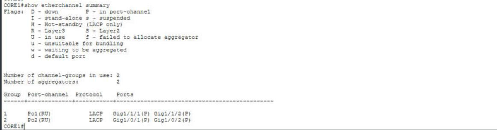

**Adyacencias OSPF:** CORE1 forma adyacencia `FULL` con CORE3 (3.3.3.3), R-Norte (4.4.4.4), R-Central1 (5.5.5.5) y CORE2 (2.2.2.2).

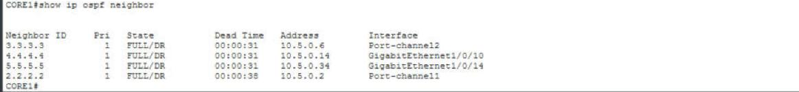

---

## 5. Tabla de VLANs

| ID | Nombre | Sede | Área funcional | Hosts requeridos |
|----|--------|------|----------------|------------------|
| 12 | Cajas | Occidente | Transacciones críticas | 45 |
| 22 | Asesores | Occidente | Servicio al cliente | 30 |
| 32 | Gerencia | Occidente | Administración local | 10 |
| 42 | Seguridad | Occidente | Cámaras y biométricos | 12 |
| 52 | Analisis | Norte | Analistas de riesgo | 50 |
| 62 | Auditoria | Norte | Revisión de cuentas | 25 |
| 72 | Legal | Norte | Contratos | 14 |
| 82 | Boveda | Oriente | Operaciones de valores | 40 |
| 92 | Plataforma | Oriente | Atención VIP | 60 |
| 13 | Core_BD | Data Center | Servidores de base de datos | 14 |
| 23 | Web_Apps | Data Center | Servidores de banca virtual | 28 |
| 33 | NOC | Data Center | Monitoreo central | 10 |

Los nombres se configuraron sin tildes para evitar problemas en IOS.

## 6. Direccionamiento IP (VLSM)

Criterio: a los hosts requeridos se les suma la IP del gateway (en Oriente, las tres IPs de HSRP: virtual, MS1 y MS2). Dentro de cada bloque las subredes se asignan de mayor a menor.

### 6.1 Bloques por sede

| Bloque | Uso |
|--------|-----|
| 10.5.0.0/24 | Enlaces punto a punto del backbone (/30) |
| 10.5.10.0/24 | Sede Occidente |
| 10.5.20.0/24 | Sede Norte |
| 10.5.30.0/24 | Sede Oriente |
| 10.5.40.0/24 | Data Center y Sede Central |

### 6.2 Subredes de usuario

| VLAN | Red | Máscara | Gateway | Rango de hosts | Broadcast |
|------|-----|---------|---------|----------------|-----------|
| 12 Cajas | 10.5.10.0/26 | 255.255.255.192 | 10.5.10.1 | .2 – .62 | 10.5.10.63 |
| 22 Asesores | 10.5.10.64/26 | 255.255.255.192 | 10.5.10.65 | .66 – .126 | 10.5.10.127 |
| 42 Seguridad | 10.5.10.128/28 | 255.255.255.240 | 10.5.10.129 | .130 – .142 | 10.5.10.143 |
| 32 Gerencia | 10.5.10.144/28 | 255.255.255.240 | 10.5.10.145 | .146 – .158 | 10.5.10.159 |
| 52 Analisis | 10.5.20.0/26 | 255.255.255.192 | 10.5.20.1 | .2 – .62 | 10.5.20.63 |
| 62 Auditoria | 10.5.20.64/27 | 255.255.255.224 | 10.5.20.65 | .66 – .94 | 10.5.20.95 |
| 72 Legal | 10.5.20.96/27 | 255.255.255.224 | 10.5.20.97 | .98 – .126 | 10.5.20.127 |
| 92 Plataforma | 10.5.30.0/25 | 255.255.255.128 | 10.5.30.1 (virtual) | .4 – .126 | 10.5.30.127 |
| 82 Boveda | 10.5.30.128/26 | 255.255.255.192 | 10.5.30.129 (virtual) | .132 – .190 | 10.5.30.191 |
| 23 Web_Apps | 10.5.40.0/27 | 255.255.255.224 | 10.5.40.1 | .2 – .30 | 10.5.40.31 |
| 13 Core_BD | 10.5.40.32/27 | 255.255.255.224 | 10.5.40.33 | .34 – .62 | 10.5.40.63 |
| 33 NOC | 10.5.40.64/28 | 255.255.255.240 | 10.5.40.65 | .66 – .78 | 10.5.40.79 |

### 6.3 Enlaces punto a punto del backbone (/30, máscara 255.255.255.252)

| # | Enlace | Red | Extremo A | Extremo B | Dominio |
|---|--------|-----|-----------|-----------|---------|
| 1 | CORE1 Po1 – CORE2 Po1 (fibra) | 10.5.0.0/30 | CORE1 .1 | CORE2 .2 | OSPF |
| 2 | CORE1 Po2 – CORE3 Po2 | 10.5.0.4/30 | CORE1 .5 | CORE3 .6 | OSPF |
| 3 | CORE2 Po3 – CORE3 Po3 | 10.5.0.8/30 | CORE2 .9 | CORE3 .10 | OSPF |
| 4 | CORE1 Gi1/0/10 – R-Norte Gi0/0 | 10.5.0.12/30 | CORE1 .13 | R-Norte .14 | OSPF |
| 5 | CORE2 Gi1/0/10 – R-Norte Gi0/1 | 10.5.0.16/30 | CORE2 .17 | R-Norte .18 | OSPF |
| 6 | CORE2 Gi1/0/11 – R-Occidente Gi0/0 | 10.5.0.20/30 | CORE2 .21 | R-Occidente .22 | EIGRP |
| 7 | CORE3 Gi1/0/12 – MS1 Gi0/1 | 10.5.0.24/30 | CORE3 .25 | MS1 .26 | RIPv2 |
| 8 | CORE3 Gi1/0/13 – MS2 Gi0/1 | 10.5.0.28/30 | CORE3 .29 | MS2 .30 | RIPv2 |
| 9 | CORE1 Gi1/0/14 – R-Central1 Gi0/0 | 10.5.0.32/30 | CORE1 .33 | R-Central1 .34 | OSPF |
| 10 | CORE3 Gi1/0/14 – R-Central1 Gi0/1 | 10.5.0.36/30 | CORE3 .37 | R-Central1 .38 | OSPF |
| 11 | R-Central1 Se0/0/0 – R-Central2 Se0/0/0 | 10.5.0.40/30 | R-Central1 .41 (DCE) | R-Central2 .42 | Estático |
| 12 | R-Central2 Gi0/0 – SW-DC-A0 Gi0/1 | 10.5.0.44/30 | R-Central2 .45 | SW-DC-A0 .46 | Estático |

Router-ID de OSPF: CORE1 1.1.1.1, CORE2 2.2.2.2, CORE3 3.3.3.3, R-Norte 4.4.4.4, R-Central1 5.5.5.5.

## 7. Inventario de equipos

| Hostname | Modelo | Módulos | Sede |
|----------|--------|---------|------|
| CORE1, CORE2 | Catalyst 3650-24PS | AC-POWER-SUPPLY, 2x GLC-LH-SMD | Backbone |
| CORE3 | Catalyst 3650-24PS | AC-POWER-SUPPLY | Backbone |
| R-Central1, R-Central2 | ISR 2911 | HWIC-2T | Sede Central |
| R-Occidente | ISR 2911 | – | Occidente |
| SW-OCC-A0, SW-OCC-A1, SW-OCC-A2 | Catalyst 2960-24TT | – | Occidente |
| R-Norte | ISR 2911 | – | Norte |
| SW-NOR-A0, SW-NOR-A1, SW-NOR-A2 | Catalyst 2960-24TT | – | Norte |
| MS1, MS2 | Catalyst 3560-24PS | – | Oriente |
| SW-ORI-A1, SW-ORI-A2 | Catalyst 2960-24TT | – | Oriente |
| SW-DC-A0 | Catalyst 3560-24PS | – | Data Center |
| SW-DC-A1, SW-DC-A2 | Catalyst 2960-24TT | – | Data Center |

Dispositivos finales: 8 PCs en Occidente, 8 PCs en Norte, 8 PCs en Oriente y 8 en el Data Center (5 servidores y 3 PCs del NOC).

---

## 8. Sedes

## 8.1 Sede Occidente (Agencia Regional Comercial)

**Dominio de enrutamiento:** EIGRP 100, con un único punto de redistribución hacia OSPF en CORE2.
**Red base:** 10.5.10.0/24.

### Topología

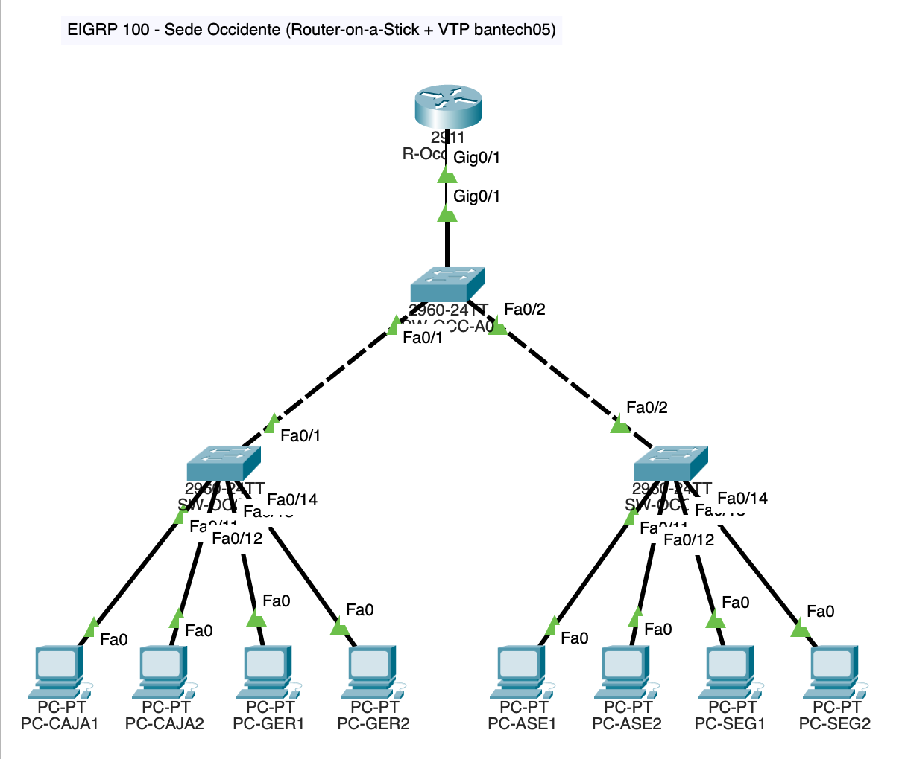

Es una estrella de dos niveles: R-Occidente está sobre el switch de distribución SW-OCC-A0, y de este cuelgan dos switches de acceso, SW-OCC-A1 y SW-OCC-A2, con 8 PCs en total.

### Mapeo lógico

| Rol | Equipo | Detalle |
|-----|--------|---------|
| Router de borde / inter-VLAN | R-Occidente (2911) | Gi0/0 hacia CORE2 (10.5.0.22/30). Gi0/1 es el troncal con las subinterfaces .12, .22, .32 y .42 |
| Switch principal / distribución | SW-OCC-A0 (2960-24TT) | Servidor VTP `bantech05` |
| Switches de acceso | SW-OCC-A1, SW-OCC-A2 (2960-24TT) | Clientes VTP |

| Enlace | Tipo |
|--------|------|
| R-Occidente Gi0/1 ↔ SW-OCC-A0 Gi0/1 | Troncal 802.1Q (straight) |
| SW-OCC-A0 Fa0/1 ↔ SW-OCC-A1 Fa0/1 | Troncal 802.1Q (cross-over) |
| SW-OCC-A0 Fa0/2 ↔ SW-OCC-A2 Fa0/2 | Troncal 802.1Q (cross-over) |
| SW-OCC-A1 Fa0/11-12 / Fa0/13-14 | Acceso VLAN 12 Cajas / VLAN 32 Gerencia |
| SW-OCC-A2 Fa0/11-12 / Fa0/13-14 | Acceso VLAN 22 Asesores / VLAN 42 Seguridad |

### VLANs y direccionamiento (VLSM)

| VLAN | Nombre | Hosts req. | Red | Máscara | Gateway (subinterfaz) | Rango útil | Broadcast |
|------|--------|-----------|-----|---------|------------------------|------------|-----------|
| 12 | Cajas | 45 | 10.5.10.0/26 | 255.255.255.192 | 10.5.10.1 (Gi0/1.12) | .2 – .62 | 10.5.10.63 |
| 22 | Asesores | 30 | 10.5.10.64/26 | 255.255.255.192 | 10.5.10.65 (Gi0/1.22) | .66 – .126 | 10.5.10.127 |
| 42 | Seguridad | 12 | 10.5.10.128/28 | 255.255.255.240 | 10.5.10.129 (Gi0/1.42) | .130 – .142 | 10.5.10.143 |
| 32 | Gerencia | 10 | 10.5.10.144/28 | 255.255.255.240 | 10.5.10.145 (Gi0/1.32) | .146 – .158 | 10.5.10.159 |

Asesores va en un /26: 30 hosts más el gateway suman 31, y un /27 solo da 30 direcciones útiles. Queda libre 10.5.10.160 – 10.5.10.255 para crecer.

| Equipo | Puerto | IP | Gateway |
|--------|--------|----|---------|
| PC-CAJA1, PC-CAJA2 | A1 Fa0/11-12 | 10.5.10.2, .3 /26 | 10.5.10.1 |
| PC-GER1, PC-GER2 | A1 Fa0/13-14 | 10.5.10.146, .147 /28 | 10.5.10.145 |
| PC-ASE1, PC-ASE2 | A2 Fa0/11-12 | 10.5.10.66, .67 /26 | 10.5.10.65 |
| PC-SEG1, PC-SEG2 | A2 Fa0/13-14 | 10.5.10.130, .131 /28 | 10.5.10.129 |

### Justificación

Elegimos una estrella con un switch de distribución porque una agencia comercial necesita, ante todo, una administración sencilla. Las cuatro VLANs se crean una sola vez en SW-OCC-A0, como servidor VTP, y A1 y A2 las aprenden como clientes. Agregar un switch de acceso nuevo es solo un troncal y `vtp mode client`.

La segmentación responde a la necesidad operativa de la sede. Cajas (A1) y Asesores (A2) quedan en switches físicos distintos y en VLANs distintas, así que un bucle, una tormenta de broadcast o una falla de hardware en el área de asesores no llega al dominio de broadcast ni al switch de las cajas. El tráfico entre áreas solo cruza por R-Occidente, que es el punto donde después se pueden aplicar ACLs.

Usamos Router-on-a-Stick porque lo exige el enunciado y porque alcanza para el volumen inter-VLAN de una agencia: la mayor parte del tráfico de Cajas sale hacia el Data Center, no hacia las otras VLANs.

En tolerancia a fallos, perder un switch de acceso afecta solo a sus áreas y no a las de la otra rama. Esta sede prioriza la segmentación sobre la redundancia física, que el enunciado pide para Norte y Oriente.

EIGRP encaja en el papel de "dominio de expansión regional": DUAL converge casi de inmediato y anunciar una agencia nueva es una sola sentencia `network`.

### Extractos de configuración

**R-Occidente**: subinterfaces 802.1Q y EIGRP.
```
interface g0/1.12
 description Cajas
 encapsulation dot1Q 12
 ip address 10.5.10.1 255.255.255.192
interface g0/1.22
 description Asesores
 encapsulation dot1Q 22
 ip address 10.5.10.65 255.255.255.192
! (.32 Gerencia 10.5.10.145/28, .42 Seguridad 10.5.10.129/28)
router eigrp 100
 no auto-summary
 network 10.5.0.20 0.0.0.3
 network 10.5.10.0 0.0.0.255
 passive-interface g0/1.12
 passive-interface g0/1.22
 passive-interface g0/1.32
 passive-interface g0/1.42
```
Los `passive-interface` hacen que EIGRP anuncie las redes de usuario sin enviar hellos hacia las PCs.

**SW-OCC-A0**: servidor VTP y VLANs con nombre.
```
vtp domain bantech05
vtp password cisco
vtp mode server
vlan 12
 name Cajas
vlan 22
 name Asesores
vlan 32
 name Gerencia
vlan 42
 name Seguridad
interface g0/1
 switchport mode trunk
interface fa0/1
 switchport mode trunk
interface fa0/2
 switchport mode trunk
```

**SW-OCC-A1**: cliente VTP y puertos de acceso. SW-OCC-A2 es análogo, con las VLANs 22 y 42.
```
vtp domain bantech05
vtp password cisco
vtp mode client
interface fa0/1
 switchport mode trunk
interface range fa0/11-12
 switchport mode access
 switchport access vlan 12
 spanning-tree portfast
interface range fa0/13-14
 switchport mode access
 switchport access vlan 32
 spanning-tree portfast
```

### Pruebas

**VTP:** A0 está en modo Server y A1 en modo Client, en el mismo dominio `bantech05`, con la misma revisión (8) y el mismo MD5 digest.

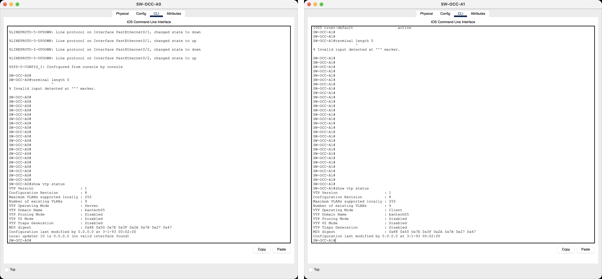

**VLANs propagadas:** en el cliente SW-OCC-A1 aparecen las 4 VLANs con su nombre sin haberlas creado localmente.

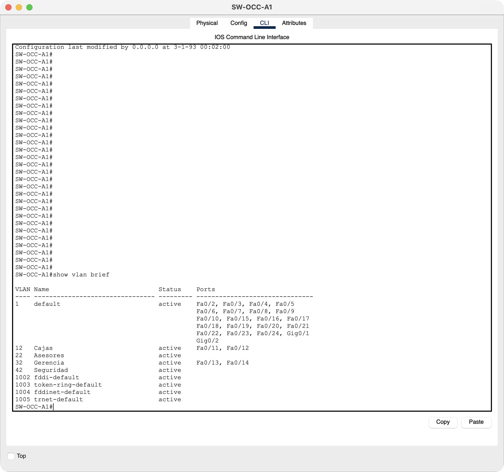

**Router-on-a-Stick:** las 4 subinterfaces están up/up y cada una es una red conectada.

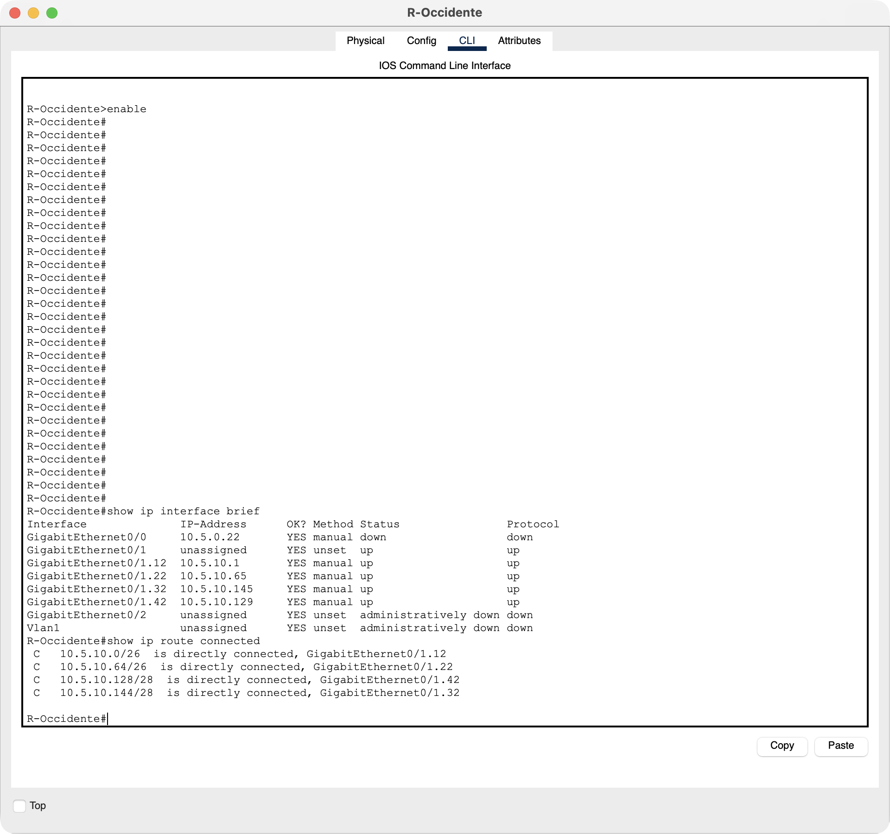

**Inter-VLAN:** PC-CAJA1 (VLAN 12) hace ping a PC-ASE1 (VLAN 22) y a PC-SEG1 (VLAN 42) con 0 % de pérdida. El TTL=127 confirma que el paquete pasó por R-Occidente.

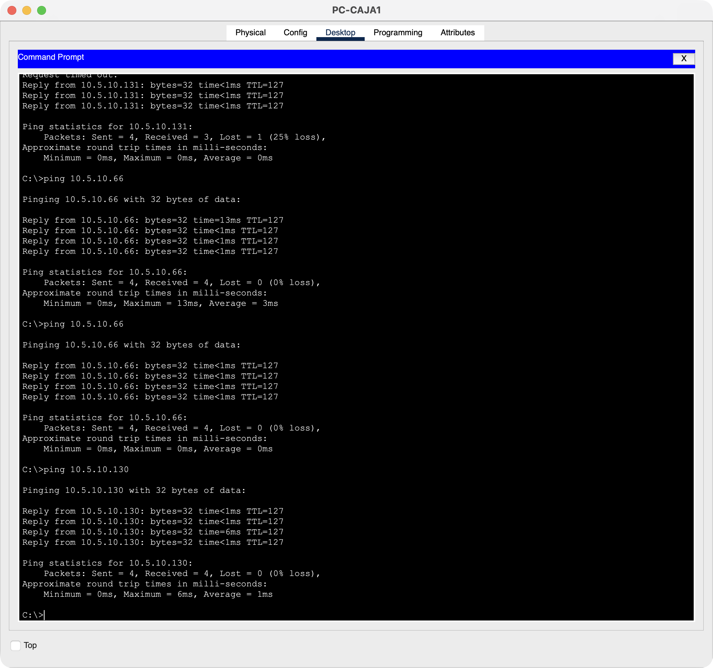

**Redistribución:** con la red integrada, R-Occidente aprende las redes de las otras sedes como `D EX` (externas de EIGRP), redistribuidas por CORE2.

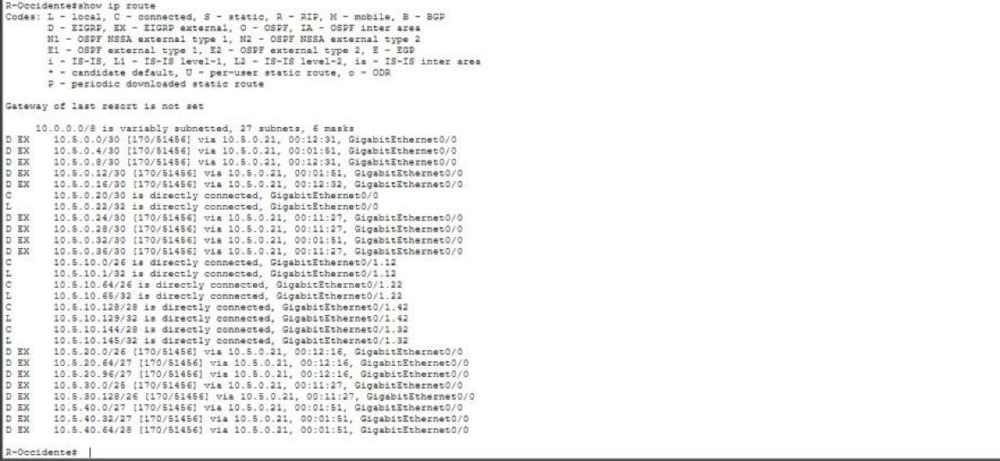

---

## 8.2 Sede Norte (Centro de Autorización de Créditos)

### Topología


Dominio de enrutamiento: OSPF área 0.

Equipos de la sede:

| Equipo    | Modelo             | Función                                            |
| --------- | ------------------ | -------------------------------------------------- |
| R-Norte   | ISR 2911           | Router de borde e inter-VLAN con Router-on-a-Stick |
| SW-NOR-A0 | Catalyst 2960-24TT | Switch principal y Root Bridge                     |
| SW-NOR-A1 | Catalyst 2960-24TT | Acceso y raíz secundaria                           |
| SW-NOR-A2 | Catalyst 2960-24TT | Acceso                                             |
| 8 PCs     | PC-PT              | Dispositivos finales                               |

### Tabla de VLANs

| ID  | Nombre    | Área funcional      | Hosts requeridos |
| --- | --------- | ------------------- | ---------------- |
| 52  | Analisis  | Analistas de Riesgo | 50               |
| 62  | Auditoria | Revisión de cuentas | 25               |
| 72  | Legal     | Contratos           | 14               |

### Subnetting VLSM sobre el bloque 10.5.20.0/24

Criterio: a los hosts requeridos se les suma una IP para el gateway. Los bloques se asignan de mayor a menor.

| VLAN         | Necesarias | Prefijo                      | Red        | Gateway    | Rango de hosts           | Broadcast   |
| ------------ | ---------- | ---------------------------- | ---------- | ---------- | ------------------------ | ----------- |
| 52 Analisis  | 51         | /26, máscara 255.255.255.192 | 10.5.20.0  | 10.5.20.1  | 10.5.20.2 a 10.5.20.62   | 10.5.20.63  |
| 62 Auditoria | 26         | /27, máscara 255.255.255.224 | 10.5.20.64 | 10.5.20.65 | 10.5.20.66 a 10.5.20.94  | 10.5.20.95  |
| 72 Legal     | 15         | /27, máscara 255.255.255.224 | 10.5.20.96 | 10.5.20.97 | 10.5.20.98 a 10.5.20.126 | 10.5.20.127 |

### Enlaces punto a punto hacia el backbone

| Enlace                         | Red          | Extremo A       | Extremo B         | Dominio |
| ------------------------------ | ------------ | --------------- | ----------------- | ------- |
| CORE1 g1/0/10 con R-Norte g0/0 | 10.5.0.12/30 | CORE1 10.5.0.13 | R-Norte 10.5.0.14 | OSPF    |
| CORE2 g1/0/10 con R-Norte g0/1 | 10.5.0.16/30 | CORE2 10.5.0.17 | R-Norte 10.5.0.18 | OSPF    |

### Dispositivos finales

| PC                | Switch y puerto           | VLAN | IP                      | Máscara         | Gateway    |
| ----------------- | ------------------------- | ---- | ----------------------- | --------------- | ---------- |
| PC-ANA1 y PC-ANA2 | SW-NOR-A1 Fa0/11 y Fa0/12 | 52   | 10.5.20.2 y 10.5.20.3   | 255.255.255.192 | 10.5.20.1  |
| PC-AUD1 y PC-AUD2 | SW-NOR-A1 Fa0/13 y Fa0/14 | 62   | 10.5.20.66 y 10.5.20.67 | 255.255.255.224 | 10.5.20.65 |
| PC-ANA3 y PC-ANA4 | SW-NOR-A2 Fa0/11 y Fa0/12 | 52   | 10.5.20.4 y 10.5.20.5   | 255.255.255.192 | 10.5.20.1  |
| PC-LEG1 y PC-LEG2 | SW-NOR-A2 Fa0/13 y Fa0/14 | 72   | 10.5.20.98 y 10.5.20.99 | 255.255.255.224 | 10.5.20.97 |

### Mapeo lógico

Switch principal: SW-NOR-A0, configurado como Root Bridge.

Enlaces troncales 802.1Q:

| Enlace                  | Puertos                                         |
| ----------------------- | ----------------------------------------------- |
| R-Norte con SW-NOR-A0   | g0/2 con Gi0/1                                  |
| SW-NOR-A0 con SW-NOR-A1 | Fa0/1 con Fa0/1                                 |
| SW-NOR-A0 con SW-NOR-A2 | Fa0/2 con Fa0/2                                 |
| SW-NOR-A1 con SW-NOR-A2 | Fa0/3 con Fa0/3, enlace que cierra el triángulo |

Puertos de acceso: Fa0/11 a Fa0/14 en SW-NOR-A1 y en SW-NOR-A2.

Enrutamiento inter-VLAN: Router-on-a-Stick en R-Norte, con las subinterfaces g0/2.52, g0/2.62 y g0/2.72.

### Justificación de la arquitectura

La sede Norte concentra a los analistas de riesgo, y de su disponibilidad depende que los créditos de todo el país puedan aprobarse. Por eso se eligió un triángulo de tres switches, que introduce bucles físicos de forma intencional. Cada switch de acceso tiene dos caminos hacia SW-NOR-A0, uno directo y otro a través del switch vecino, de modo que ningún cable ni ningún switch de acceso es un punto único de falla. Rapid PVST+ mantiene bloqueado un solo puerto, SW-NOR-A2 Fa0/3, para evitar tormentas de broadcast, y lo habilita en segundos si falla un enlace activo. SW-NOR-A0 se forzó como Root Bridge con prioridad 24576 porque es el switch al que se conecta R-Norte, así el tráfico hacia el gateway sigue siempre el camino más corto. SW-NOR-A1 quedó como raíz secundaria con prioridad 28672, de modo que si A0 falla el reemplazo es predecible y no queda al azar de las direcciones MAC.

Se usó Router-on-a-Stick porque los switches son de capa 2 y un único enlace troncal es suficiente para el tráfico entre las tres VLANs de una sede de este tamaño. La sede se asignó al dominio OSPF porque es la más crítica del corporativo. Al estar en el mismo dominio que el núcleo no depende de redistribución, y sus dos salidas hacia CORE1 y CORE2 convergen con rapidez gracias al enrutamiento por estado de enlace.

### Configuraciones clave

Los archivos completos de cada equipo están en la carpeta `configs`.

Las VLANs se crean en SW-NOR-A0, SW-NOR-A1 y SW-NOR-A2. No aparecen en la salida de `show running-config` porque Packet Tracer las guarda en el archivo `vlan.dat`.

```
vlan 52
 name Analisis
vlan 62
 name Auditoria
vlan 72
 name Legal
```

SW-NOR-A0, Root Bridge:

```
hostname SW-NOR-A0
spanning-tree mode rapid-pvst
spanning-tree vlan 52,62,72 priority 24576
interface FastEthernet0/1
 description Troncal hacia SW-NOR-A1
 switchport mode trunk
interface FastEthernet0/2
 description Troncal hacia SW-NOR-A2
 switchport mode trunk
interface GigabitEthernet0/1
 description Troncal hacia R-Norte
 switchport mode trunk
```

El comando aplicado fue `spanning-tree vlan 52,62,72 root primary`, que IOS guarda como prioridad 24576.

SW-NOR-A1, raíz secundaria:

```
hostname SW-NOR-A1
spanning-tree mode rapid-pvst
spanning-tree vlan 52,62,72 priority 28672
interface FastEthernet0/1
 description Troncal hacia SW-NOR-A0
 switchport mode trunk
interface FastEthernet0/3
 description Troncal hacia SW-NOR-A2
 switchport mode trunk
interface range FastEthernet0/11-12
 switchport mode access
 switchport access vlan 52
 spanning-tree portfast
interface range FastEthernet0/13-14
 switchport mode access
 switchport access vlan 62
 spanning-tree portfast
```

El comando aplicado fue `spanning-tree vlan 52,62,72 root secondary`, que IOS guarda como prioridad 28672.

SW-NOR-A2, acceso:

```
hostname SW-NOR-A2
spanning-tree mode rapid-pvst
interface FastEthernet0/2
 description Troncal hacia SW-NOR-A0
 switchport mode trunk
interface FastEthernet0/3
 description Troncal hacia SW-NOR-A1
 switchport mode trunk
interface range FastEthernet0/11-12
 switchport mode access
 switchport access vlan 52
 spanning-tree portfast
interface range FastEthernet0/13-14
 switchport mode access
 switchport access vlan 72
 spanning-tree portfast
```

R-Norte, Router-on-a-Stick y OSPF:

```
hostname R-Norte
interface GigabitEthernet0/0
 description Hacia CORE1 g1/0/10
 ip address 10.5.0.14 255.255.255.252
interface GigabitEthernet0/1
 description Hacia CORE2 g1/0/10
 ip address 10.5.0.18 255.255.255.252
interface GigabitEthernet0/2
 description Troncal hacia SW-NOR-A0
interface GigabitEthernet0/2.52
 description Analisis
 encapsulation dot1Q 52
 ip address 10.5.20.1 255.255.255.192
interface GigabitEthernet0/2.62
 description Auditoria
 encapsulation dot1Q 62
 ip address 10.5.20.65 255.255.255.224
interface GigabitEthernet0/2.72
 description Legal
 encapsulation dot1Q 72
 ip address 10.5.20.97 255.255.255.224
router ospf 1
 router-id 4.4.4.4
 passive-interface GigabitEthernet0/2.52
 passive-interface GigabitEthernet0/2.62
 passive-interface GigabitEthernet0/2.72
 network 10.5.0.12 0.0.0.3 area 0
 network 10.5.0.16 0.0.0.3 area 0
 network 10.5.20.0 0.0.0.255 area 0
```

### Pruebas

Enrutamiento inter-VLAN. Los pings entre VLANs distintas responden con TTL 127, lo que confirma que el tráfico atraviesa R-Norte. El primer paquete se pierde mientras se resuelve el ARP y los siguientes responden sin pérdida.

Root Bridge. SW-NOR-A0 es la raíz de la VLAN 52 con prioridad 24628, que resulta de sumar 24576 y el número de VLAN.


Puerto bloqueado. En SW-NOR-A2 el puerto Fa0/2 es el puerto raíz y Fa0/3 queda en estado Altn BLK, que corresponde al enlace entre SW-NOR-A1 y SW-NOR-A2.


Conmutación por error de STP. Con un ping continuo desde PC-ANA1 hacia el gateway 10.5.20.1 se apagó la interfaz Fa0/1 de SW-NOR-A0. El puerto bloqueado pasó a reenviar tráfico y el ping se recuperó después de 2 tiempos de espera agotados.


## 8.3 Sede Oriente (Centro Financiero Legado)

### Topología


Dominio de enrutamiento: RIPv2.

Equipos de la sede:

| Equipo    | Modelo             | Función                                            |
| --------- | ------------------ | -------------------------------------------------- |
| MS1       | Catalyst 3560-24PS | Switch multicapa, HSRP activo y Root Bridge        |
| MS2       | Catalyst 3560-24PS | Switch multicapa, HSRP en espera y raíz secundaria |
| SW-ORI-A1 | Catalyst 2960-24TT | Acceso de la VLAN Boveda                           |
| SW-ORI-A2 | Catalyst 2960-24TT | Acceso de la VLAN Plataforma                       |
| 8 PCs     | PC-PT              | Dispositivos finales                               |

### Tabla de VLANs

| ID  | Nombre     | Área funcional         | Hosts requeridos |
| --- | ---------- | ---------------------- | ---------------- |
| 82  | Boveda     | Operaciones de valores | 40               |
| 92  | Plataforma | Atención VIP           | 60               |

### Subnetting VLSM sobre el bloque 10.5.30.0/24

Criterio: a los hosts requeridos se les suman tres IPs de HSRP, que son la virtual, la de MS1 y la de MS2.

| VLAN          | Necesarias | Prefijo                      | Red         | IP virtual  | MS1         | MS2         | Rango de hosts            | Broadcast   |
| ------------- | ---------- | ---------------------------- | ----------- | ----------- | ----------- | ----------- | ------------------------- | ----------- |
| 92 Plataforma | 63         | /25, máscara 255.255.255.128 | 10.5.30.0   | 10.5.30.1   | 10.5.30.2   | 10.5.30.3   | 10.5.30.4 a 10.5.30.126   | 10.5.30.127 |
| 82 Boveda     | 43         | /26, máscara 255.255.255.192 | 10.5.30.128 | 10.5.30.129 | 10.5.30.130 | 10.5.30.131 | 10.5.30.132 a 10.5.30.190 | 10.5.30.191 |

La VLAN Plataforma necesita un /25 porque 60 hosts más 3 IPs de HSRP suman 63, que supera los 62 utilizables de un /26.

### Enlaces punto a punto hacia el backbone

| Enlace                     | Red          | Extremo A       | Extremo B     | Dominio |
| -------------------------- | ------------ | --------------- | ------------- | ------- |
| CORE3 g1/0/12 con MS1 g0/1 | 10.5.0.24/30 | CORE3 10.5.0.25 | MS1 10.5.0.26 | RIPv2   |
| CORE3 g1/0/13 con MS2 g0/1 | 10.5.0.28/30 | CORE3 10.5.0.29 | MS2 10.5.0.30 | RIPv2   |

### Dispositivos finales

El gateway de todas las PCs es la IP virtual de HSRP.

| PC                | Switch y puerto           | VLAN | IP                        | Máscara         | Gateway     |
| ----------------- | ------------------------- | ---- | ------------------------- | --------------- | ----------- |
| PC-BOV1 a PC-BOV4 | SW-ORI-A1 Fa0/11 a Fa0/14 | 82   | 10.5.30.132 a 10.5.30.135 | 255.255.255.192 | 10.5.30.129 |
| PC-PLA1 a PC-PLA4 | SW-ORI-A2 Fa0/11 a Fa0/14 | 92   | 10.5.30.4 a 10.5.30.7     | 255.255.255.128 | 10.5.30.1   |

### Mapeo lógico

Switches principales: MS1 como activo y MS2 como respaldo.

Enlaces troncales 802.1Q:

| Enlace               | Puertos         |
| -------------------- | --------------- |
| MS1 con MS2, cascada | Gi0/2 con Gi0/2 |
| MS1 con SW-ORI-A1    | Fa0/1 con Fa0/1 |
| MS2 con SW-ORI-A1    | Fa0/2 con Fa0/2 |
| MS1 con SW-ORI-A2    | Fa0/3 con Fa0/3 |
| MS2 con SW-ORI-A2    | Fa0/4 con Fa0/4 |

Enlaces ruteados: MS1 Gi0/1 y MS2 Gi0/1 hacia CORE3.

Puertos de acceso: Fa0/11 a Fa0/14 en SW-ORI-A1 y en SW-ORI-A2.

Enrutamiento inter-VLAN: interfaces virtuales Vlan82 y Vlan92 en MS1 y MS2, que cuentan con `ip routing` habilitado.

### Justificación de la arquitectura

El Centro Financiero Legado es una sede crítica cuyos usuarios no pueden perder conectividad hacia el núcleo, incluso si MS1 sufre un corte de energía. Para cumplirlo, cada switch de acceso se conecta de forma simultánea a MS1 y a MS2, de manera que ni la capa 2 ni la capa 3 dependen de un solo equipo. MS1 y MS2 también se conectan entre sí por un enlace troncal en cascada, y cada uno tiene su propio enlace ruteado hacia CORE3, lo que da dos salidas independientes hacia el backbone.

Se eligió HSRP porque es el protocolo nativo de Cisco, está soportado por Packet Tracer y es el que pide la rúbrica. Cada VLAN tiene una IP virtual que las PCs usan como gateway, por lo que si MS1 falla, MS2 asume el rol activo sin que haya que cambiar nada en los equipos finales. MS1 tiene prioridad 110 y preempt, así recupera el rol cuando regresa. Además, MS1 es el Root Bridge de Rapid PVST+ con prioridad 24576, alineado con su rol de gateway activo, y así el camino de capa 2 coincide con el de capa 3 y se evitan rutas subóptimas. MS2 es la raíz secundaria con prioridad 28672.

La sede se asignó al dominio RIPv2 por ser la red legada del banco adquirido. De esa forma se integra al corporativo sin migrarla de inmediato, y queda aislada detrás del punto de redistribución del backbone.

### Configuraciones clave

Los archivos completos de cada equipo están en la carpeta `configs`.

Las VLANs se crean en MS1, MS2, SW-ORI-A1 y SW-ORI-A2. No aparecen en la salida de `show running-config` porque Packet Tracer las guarda en el archivo `vlan.dat`.

```
vlan 82
 name Boveda
vlan 92
 name Plataforma
```

MS1, HSRP activo y Root Bridge:

```
hostname MS1
ip routing
spanning-tree mode rapid-pvst
spanning-tree vlan 82,92 priority 24576
interface GigabitEthernet0/1
 description Enlace ruteado hacia CORE3 g1/0/12
 no switchport
 ip address 10.5.0.26 255.255.255.252
interface GigabitEthernet0/2
 description Cascada hacia MS2
 switchport trunk encapsulation dot1q
 switchport mode trunk
interface FastEthernet0/1
 description Troncal hacia SW-ORI-A1
 switchport trunk encapsulation dot1q
 switchport mode trunk
interface FastEthernet0/3
 description Troncal hacia SW-ORI-A2
 switchport trunk encapsulation dot1q
 switchport mode trunk
interface Vlan82
 ip address 10.5.30.130 255.255.255.192
 standby 82 ip 10.5.30.129
 standby 82 priority 110
 standby 82 preempt
interface Vlan92
 ip address 10.5.30.2 255.255.255.128
 standby 92 ip 10.5.30.1
 standby 92 priority 110
 standby 92 preempt
router rip
 version 2
 network 10.0.0.0
 no auto-summary
```

MS2, HSRP en espera y raíz secundaria:

```
hostname MS2
ip routing
spanning-tree mode rapid-pvst
spanning-tree vlan 82,92 priority 28672
interface GigabitEthernet0/1
 description Enlace ruteado hacia CORE3 g1/0/13
 no switchport
 ip address 10.5.0.30 255.255.255.252
interface GigabitEthernet0/2
 description Cascada hacia MS1
 switchport trunk encapsulation dot1q
 switchport mode trunk
interface FastEthernet0/2
 description Troncal hacia SW-ORI-A1
 switchport trunk encapsulation dot1q
 switchport mode trunk
interface FastEthernet0/4
 description Troncal hacia SW-ORI-A2
 switchport trunk encapsulation dot1q
 switchport mode trunk
interface Vlan82
 ip address 10.5.30.131 255.255.255.192
 standby 82 ip 10.5.30.129
 standby 82 preempt
interface Vlan92
 ip address 10.5.30.3 255.255.255.128
 standby 92 ip 10.5.30.1
 standby 92 preempt
router rip
 version 2
 network 10.0.0.0
 no auto-summary
```

En MS2 no aparece la línea de prioridad de HSRP porque su valor es 100, que es el predeterminado.

SW-ORI-A1, acceso de Boveda:

```
hostname SW-ORI-A1
spanning-tree mode rapid-pvst
interface FastEthernet0/1
 description Uplink hacia MS1
 switchport mode trunk
interface FastEthernet0/2
 description Uplink hacia MS2
 switchport mode trunk
interface range FastEthernet0/11-14
 switchport mode access
 switchport access vlan 82
 spanning-tree portfast
```

SW-ORI-A2, acceso de Plataforma:

```
hostname SW-ORI-A2
spanning-tree mode rapid-pvst
interface FastEthernet0/3
 description Uplink hacia MS1
 switchport mode trunk
interface FastEthernet0/4
 description Uplink hacia MS2
 switchport mode trunk
interface range FastEthernet0/11-14
 switchport mode access
 switchport access vlan 92
 spanning-tree portfast
```

### Pruebas

Estado de HSRP antes de la falla. MS1 está en estado Active con prioridad 110 y MS2 en estado Standby con prioridad 100, en las VLANs 82 y 92. La IP virtual es 10.5.30.129 para Boveda y 10.5.30.1 para Plataforma.


Enrutamiento inter-VLAN y gateways virtuales. El ping de una PC de Boveda hacia una de Plataforma responde con TTL 127, y los pings a las IPs virtuales 10.5.30.129 y 10.5.30.1 responden con TTL 255 y sin pérdida.

Conmutación por error de HSRP. Con un ping continuo desde PC-PLA1 hacia PC-BOV1 en 10.5.30.132, que cruza el gateway, se simuló el corte de MS1 apagando sus interfaces Fa0/1, Fa0/3 y Gi0/2. El ping se recuperó después de 4 tiempos de espera agotados y MS2 asumió el rol Active. Al restaurar los enlaces, MS1 recuperó el rol Active gracias a preempt, como lo muestran los mensajes de cambio de estado de HSRP en las VLANs 82 y 92.


La misma prueba repetida con la red integrada, con tráfico hacia el Data Center, está en la sección 10.2.

---

## 8.4 Data Center y Sede Central (Alta Seguridad)

**Dominio de enrutamiento:** rutas estáticas. SW-DC-A0 → R-Central2 → R-Central1, y R-Central1 redistribuye a OSPF.
**Red base:** 10.5.40.0/24.

### Topología

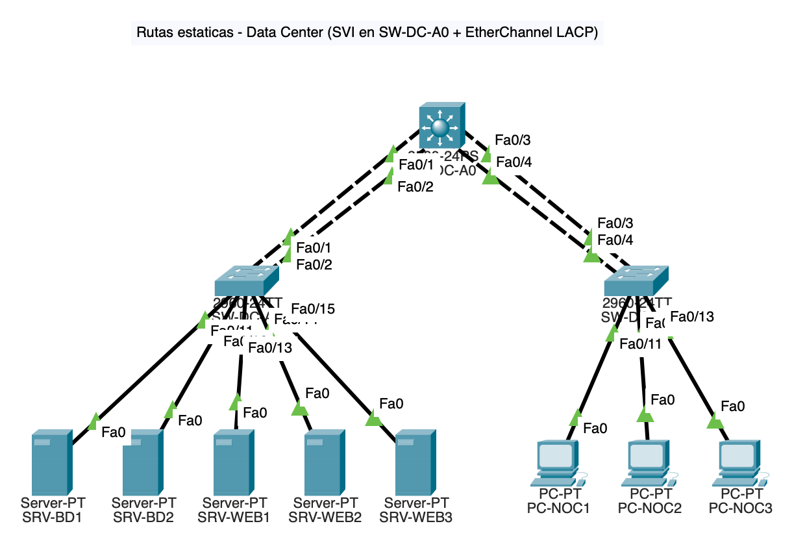

Es una topología de distribución y acceso: el switch multicapa SW-DC-A0 se enlaza a R-Central2 por un puerto ruteado y a cada switch de acceso por un EtherChannel de 2 cables.

### Mapeo lógico

| Rol | Equipo | Detalle |
|-----|--------|---------|
| Switch principal / distribución (L3) | SW-DC-A0 (3560-24PS) | `ip routing`, SVIs de las VLANs 13, 23 y 33, Gi0/1 ruteado hacia R-Central2 (10.5.0.46/30) |
| Acceso a servidores | SW-DC-A1 (2960-24TT) | Core_BD y Web_Apps |
| Acceso NOC | SW-DC-A2 (2960-24TT) | NOC |

| Enlace | Tipo |
|--------|------|
| SW-DC-A0 Gi0/1 ↔ R-Central2 Gi0/0 | Puerto ruteado (`no switchport`), 10.5.0.44/30 |
| SW-DC-A0 Fa0/1-2 ↔ SW-DC-A1 Fa0/1-2 | Po1: troncal 802.1Q, EtherChannel LACP |
| SW-DC-A0 Fa0/3-4 ↔ SW-DC-A2 Fa0/3-4 | Po2: troncal 802.1Q, EtherChannel LACP |
| SW-DC-A1 Fa0/11-12 / Fa0/13-15 | Acceso VLAN 13 Core_BD / VLAN 23 Web_Apps |
| SW-DC-A2 Fa0/11-13 | Acceso VLAN 33 NOC |

### VLANs y direccionamiento (VLSM)

| VLAN | Nombre | Hosts req. | Red | Máscara | Gateway (SVI) | Rango útil | Broadcast |
|------|--------|-----------|-----|---------|---------------|------------|-----------|
| 23 | Web_Apps | 28 | 10.5.40.0/27 | 255.255.255.224 | 10.5.40.1 | .2 – .30 | 10.5.40.31 |
| 13 | Core_BD | 14 | 10.5.40.32/27 | 255.255.255.224 | 10.5.40.33 | .34 – .62 | 10.5.40.63 |
| 33 | NOC | 10 | 10.5.40.64/28 | 255.255.255.240 | 10.5.40.65 | .66 – .78 | 10.5.40.79 |

Core_BD necesita un /27: 14 hosts más el gateway suman 15, y un /28 solo da 14 direcciones útiles.

| Equipo | Puerto | IP | Gateway |
|--------|--------|----|---------|
| SRV-BD1, SRV-BD2 | A1 Fa0/11-12 | 10.5.40.34, .35 /27 | 10.5.40.33 |
| SRV-WEB1, SRV-WEB2, SRV-WEB3 | A1 Fa0/13-15 | 10.5.40.2, .3, .4 /27 | 10.5.40.1 |
| PC-NOC1, PC-NOC2, PC-NOC3 | A2 Fa0/11-13 | 10.5.40.66, .67, .68 /28 | 10.5.40.65 |

### Justificación

La capa de distribución multicapa saca el enrutamiento inter-VLAN del router: SW-DC-A0 enruta entre Core_BD, Web_Apps y NOC por hardware, con sus SVIs, sin el cuello de botella de un único troncal hacia un router. El tráfico servidor-servidor, como Web_Apps consultando Core_BD, nunca sale del switch.

La necesidad operativa es absorber ráfagas masivas de tráfico, y por eso cada switch de acceso se conecta con un EtherChannel LACP (IEEE 802.3ad) de 2 enlaces. Así se suma el ancho de banda y el balanceo reparte los flujos entre los miembros.

En tolerancia a fallos, si un cable del canal cae, el Port-channel sigue arriba con el otro miembro: no hay reconvergencia de STP ni pérdida de servicio. Elegimos LACP en lugar de PAgP porque es un estándar abierto.

La seguridad se resuelve con enrutamiento estático. SW-DC-A0 solo tiene una ruta por defecto hacia R-Central2, y ningún protocolo dinámico anuncia ni aprende rutas dentro del segmento. Lo que el resto de la red conoce del Data Center son exactamente las 3 redes que R-Central1 redistribuye a OSPF.

### Extractos de configuración

**SW-DC-A0**: SVIs, EtherChannel y ruta por defecto.
```
ip routing
vlan 13
 name Core_BD
vlan 23
 name Web_Apps
vlan 33
 name NOC
interface g0/1
 no switchport
 ip address 10.5.0.46 255.255.255.252
interface range fa0/1-2
 switchport trunk encapsulation dot1q
 switchport mode trunk
 channel-group 1 mode active
interface range fa0/3-4
 switchport trunk encapsulation dot1q
 switchport mode trunk
 channel-group 2 mode active
interface vlan 13
 ip address 10.5.40.33 255.255.255.224
interface vlan 23
 ip address 10.5.40.1 255.255.255.224
interface vlan 33
 ip address 10.5.40.65 255.255.255.240
ip route 0.0.0.0 0.0.0.0 10.5.0.45
```

**SW-DC-A1**: extremo LACP de Po1 y accesos. SW-DC-A2 es análogo, con Po2 en Fa0/3-4 y la VLAN 33.
```
interface range fa0/1-2
 switchport mode trunk
 channel-group 1 mode active
interface range fa0/11-12
 switchport mode access
 switchport access vlan 13
 spanning-tree portfast
interface range fa0/13-15
 switchport mode access
 switchport access vlan 23
 spanning-tree portfast
```

### Pruebas

**EtherChannel:** Po1 y Po2 están en `(SU)` (capa 2, en uso), con protocolo LACP y ambos miembros en `(P)`.

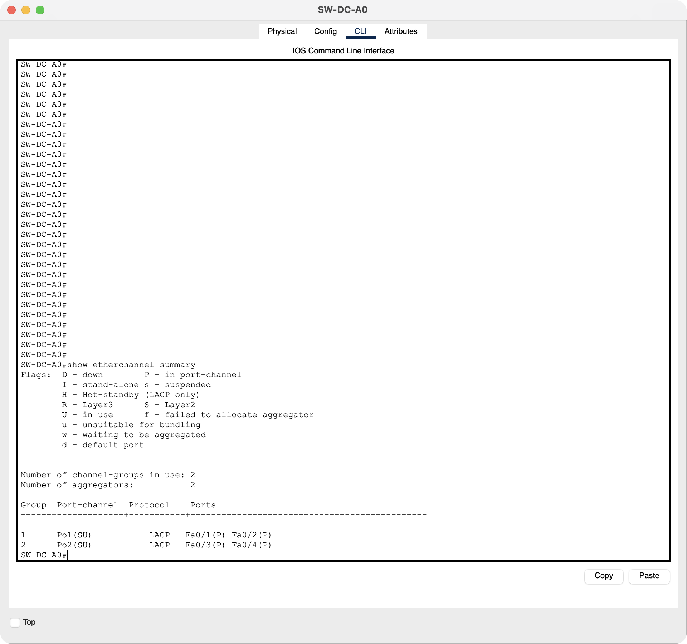

**Troncales e inter-VLAN:** los Port-channel están trunking con las VLANs 13, 23 y 33 activas, y las tres SVIs son redes conectadas.

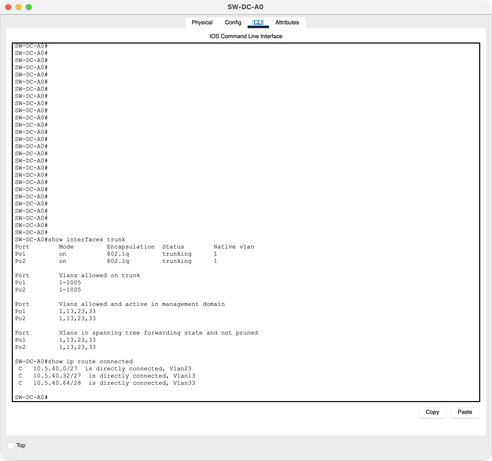

**Failover del EtherChannel:** con `shutdown` en SW-DC-A0 Fa0/1, el miembro queda en `(D)` pero Po1 sigue `(SU)` con Fa0/2. A la izquierda se ve el estado del canal, y a la derecha PC-NOC1 (VLAN 33) llegando a SRV-BD1 (VLAN 13) con 0 % de pérdida por el miembro que queda.

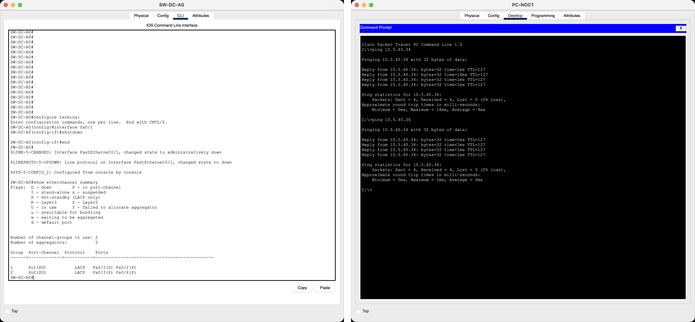

---

## 9. Pruebas de convergencia

### 9.1 Conectividad de extremo a extremo

**Occidente → Data Center:** PC-CAJA1 (10.5.10.2, VLAN 12) alcanza a SRV-BD1 (10.5.40.34, VLAN 13) con 0 % de pérdida. El paquete atraviesa los cuatro tipos de enrutamiento: EIGRP en R-Occidente, OSPF en el núcleo, la redistribución de estáticas en R-Central1 y las rutas estáticas de R-Central2 y SW-DC-A0.

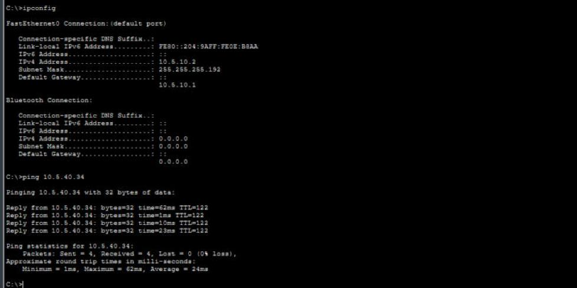

**Norte → Oriente:** PC-ANA1 (10.5.20.2, VLAN 52) alcanza a PC-PLA1 (10.5.30.4, VLAN 92) con 0 % de pérdida, cruzando de OSPF a RIPv2 por el punto de redistribución de CORE3.

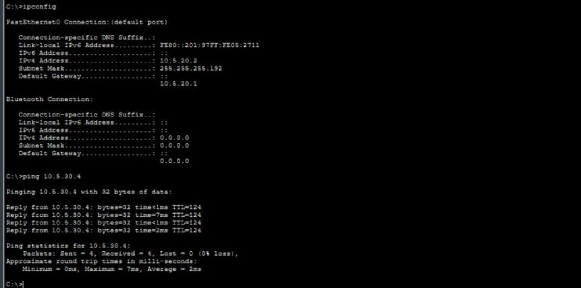

### 9.2 Tablas de enrutamiento de los routers frontera

**CORE2 (OSPF ↔ EIGRP):** las redes de Occidente aparecen como `D` (aprendidas por EIGRP), las de Norte como `O` y las de Oriente y del Data Center como `O E2` (externas redistribuidas en CORE3 y R-Central1).

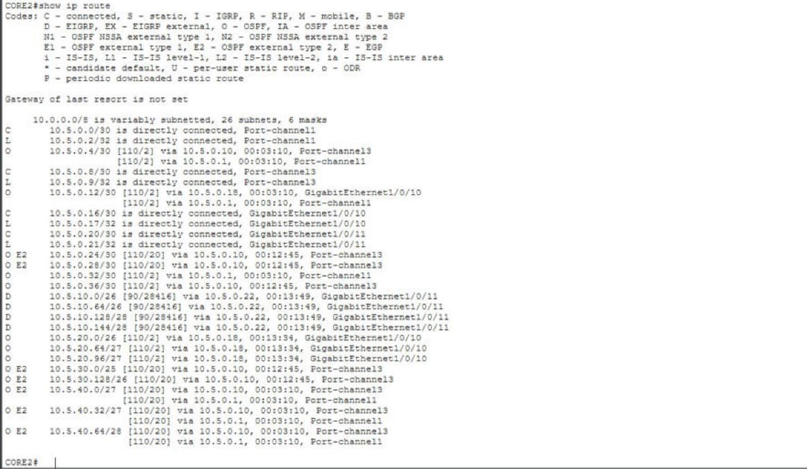

**CORE3 (OSPF ↔ RIPv2):** las redes de Oriente aparecen como `R` con dos caminos (MS1 y MS2); Occidente y el Data Center como `O E2` y Norte como `O`.

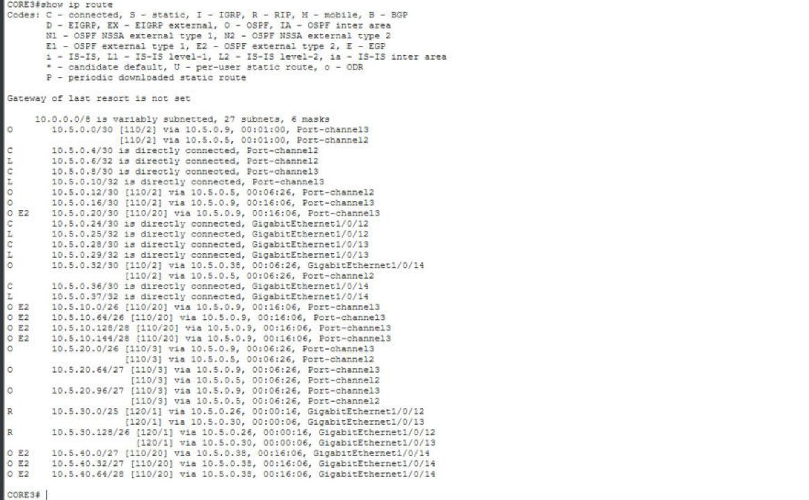

**R-Central1 (estáticas → OSPF):** las tres redes del Data Center son `S` vía R-Central2 (10.5.0.42), y el resto de la red se aprende por OSPF con doble camino hacia CORE1 y CORE3.

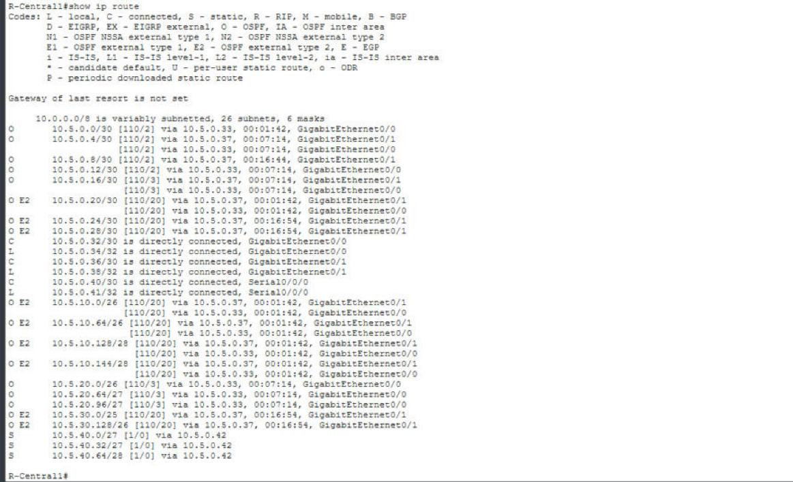

**R-Occidente (dominio EIGRP):** todas las redes externas a la sede llegan como `D EX`, lo que confirma la redistribución OSPF → EIGRP en CORE2.


**MS1 (dominio RIPv2):** todas las redes externas a la sede llegan como `R`, lo que confirma la redistribución OSPF → RIPv2 en CORE3.


---

## 10. Pruebas de alta disponibilidad

### 10.1 Tolerancia a fallos del núcleo

Desde CORE2 se ejecutó `traceroute` hacia R-Central1 (10.5.0.34). Con el Port-channel1 de fibra activo, el primer salto es CORE1 (10.5.0.1). Después de aplicar `shutdown` a Po1, OSPF reconverge y el tráfico sale por un camino alterno sin intervención manual.

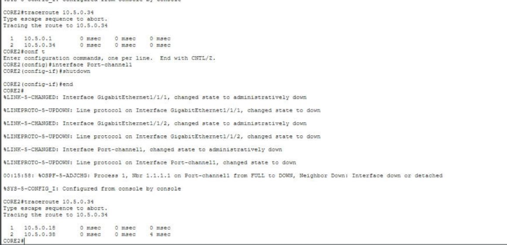

También se apagó por completo CORE1: tras la reconvergencia de OSPF (unos segundos), los pings de Occidente al Data Center, de Norte al Data Center y de Oriente a Occidente respondieron con 0 % de pérdida por CORE2 y CORE3, lo que demuestra que el triángulo no tiene punto único de falla.

### 10.2 HSRP en la Sede Oriente integrado al backbone

Con un `ping -t` desde PC-PLA1 (VLAN 92) hacia SRV-BD1 en el Data Center se apagó MS1 desde la pestaña Physical (corte de energía). Se pierden tres paquetes mientras MS2 toma el rol activo y el tráfico hacia el núcleo continúa sin cambiar nada en la PC, que mantiene como gateway la IP virtual 10.5.30.1.

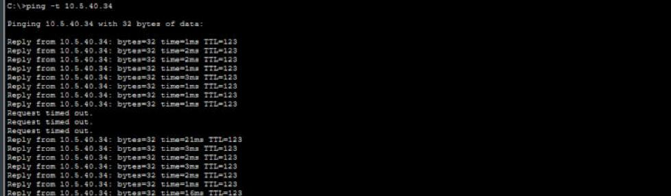

Durante la falla, MS2 queda como `Active` en ambos grupos y el estado Standby aparece como `unknown` porque MS1 está apagado:

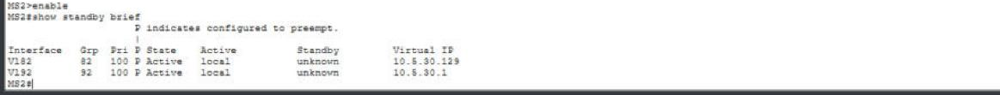

Al volver a encender MS1, recupera el rol `Active` gracias a `preempt` y MS2 regresa a `Standby`.

### 10.3 Otras pruebas de redundancia

- **Rapid PVST+ en Norte:** sección 8.2, prueba de conmutación por error de STP.
- **HSRP dentro de la sede Oriente:** sección 8.3.
- **EtherChannel del Data Center:** sección 8.4, falla de un miembro del Port-channel.

---

## 11. Conclusiones y mejoras

### Conclusiones

- La red integra cuatro métodos de enrutamiento (OSPF, EIGRP, RIPv2 y estáticas) con un único punto de redistribución por dominio externo, y todas las sedes se comunican de extremo a extremo.
- El núcleo en triángulo con EtherChannel LACP tolera la caída de un enlace, de un Port-channel completo o de un switch de núcleo sin pérdida de conectividad.
- Cada sede responde a su necesidad operativa: segmentación y administración centralizada en Occidente, redundancia de capa 2 en Norte, gateway redundante en Oriente y ancho de banda agregado con aislamiento en el Data Center.

### Mejoras posibles

- Dar doble punto de redistribución a Occidente y Oriente (por ejemplo, conectar R-Occidente también a CORE1) usando etiquetas de ruta (`route-map` con `tag`) para evitar bucles.
- Aumentar el costo OSPF de los enlaces de R-Norte hacia el núcleo para que la sede no funcione como tránsito cuando cae un enlace del backbone.
- Cambiar la VLAN nativa de los troncales a una VLAN sin uso y apagar los puertos de acceso libres.
- Configurar autenticación en OSPF y EIGRP, y SSH en lugar de Telnet para la administración.
