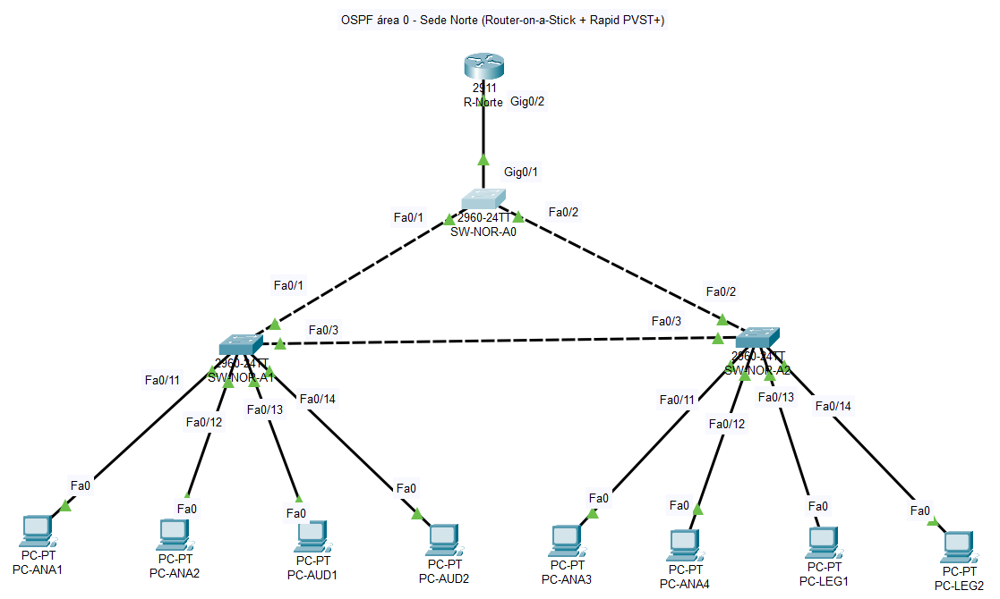
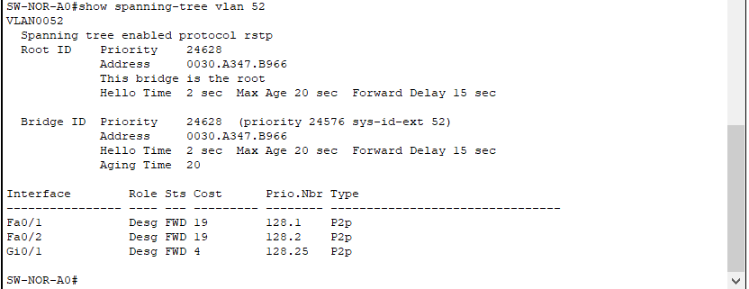
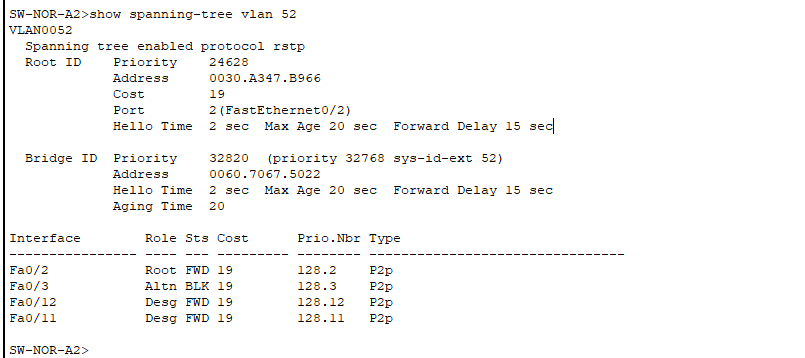
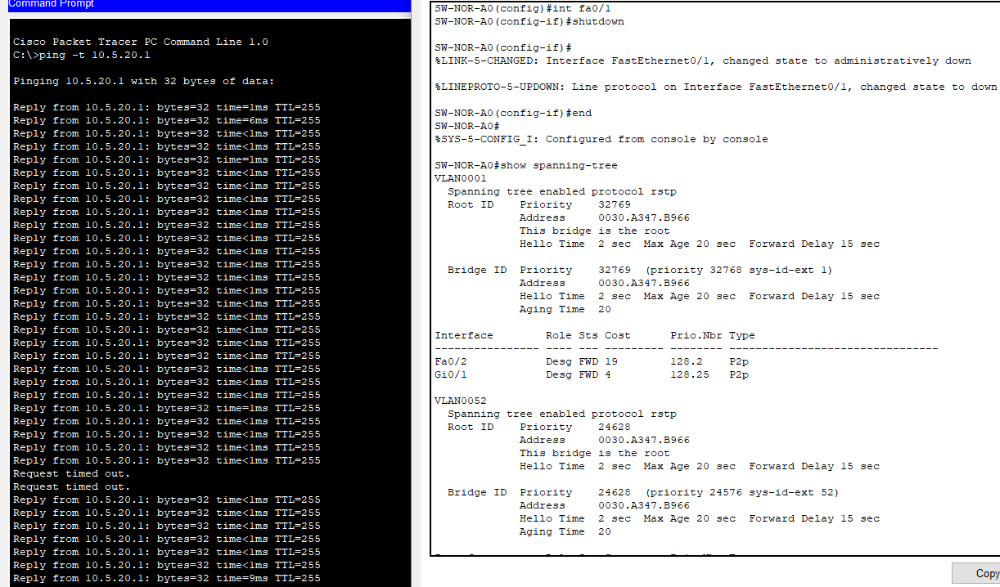
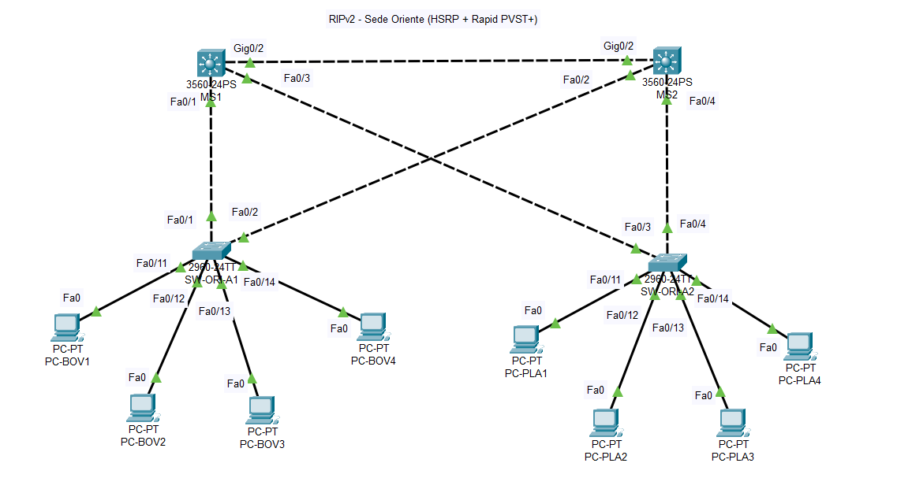
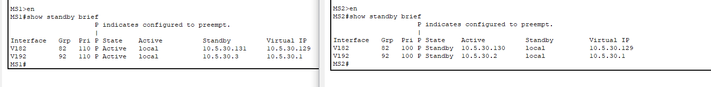
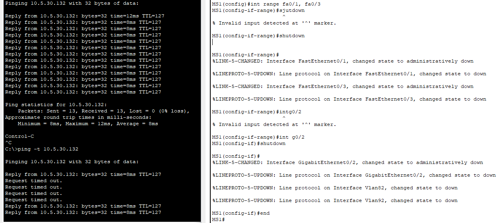
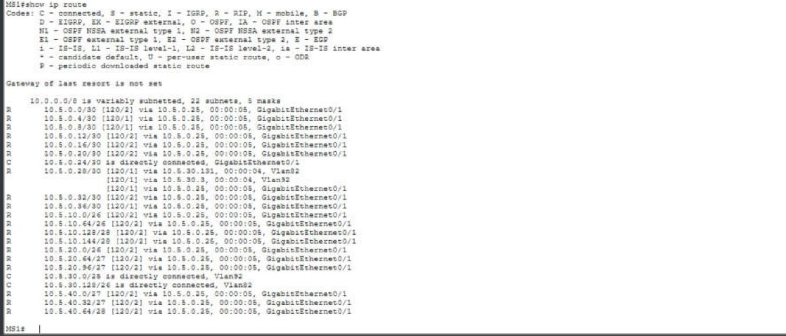

# Secciones Norte y Oriente

## Sede Norte (Centro de Autorización de Créditos)

### Topología



Dominio de enrutamiento: **OSPF área 0**. Equipos: R-Norte (ISR 2911), SW-NOR-A0, SW-NOR-A1 y SW-NOR-A2 (Catalyst 2960-24TT) y 8 PCs.

### Tabla de VLANs

| ID  | Nombre    | Área funcional      | Hosts requeridos |
| --- | --------- | ------------------- | ---------------- |
| 52  | Analisis  | Analistas de Riesgo | 50               |
| 62  | Auditoria | Revisión de cuentas | 25               |
| 72  | Legal     | Contratos           | 14               |

### Subnetting (VLSM) – bloque 10.5.20.0/24

Criterio: hosts requeridos + 1 IP de gateway.

| VLAN         | Necesarias | Prefijo               | Red        | Gateway    | Rango de hosts | Broadcast   |
| ------------ | ---------- | --------------------- | ---------- | ---------- | -------------- | ----------- |
| 52 Analisis  | 51         | /26 (255.255.255.192) | 10.5.20.0  | 10.5.20.1  | .2 – .62       | 10.5.20.63  |
| 62 Auditoria | 26         | /27 (255.255.255.224) | 10.5.20.64 | 10.5.20.65 | .66 – .94      | 10.5.20.95  |
| 72 Legal     | 15         | /27 (255.255.255.224) | 10.5.20.96 | 10.5.20.97 | .98 – .126     | 10.5.20.127 |

### Enlaces punto a punto de R-Norte (/30)

| Enlace                       | Red          | Extremo A | Extremo B   | Dominio |
| ---------------------------- | ------------ | --------- | ----------- | ------- |
| CORE1 g1/0/10 – R-Norte g0/0 | 10.5.0.12/30 | CORE1 .13 | R-Norte .14 | OSPF    |
| CORE2 g1/0/10 – R-Norte g0/1 | 10.5.0.16/30 | CORE2 .17 | R-Norte .18 | OSPF    |

### Dispositivos finales

| PC               | Switch / puerto     | VLAN | IP              | Máscara         | Gateway    |
| ---------------- | ------------------- | ---- | --------------- | --------------- | ---------- |
| PC-ANA1, PC-ANA2 | SW-NOR-A1 Fa0/11-12 | 52   | 10.5.20.2, .3   | 255.255.255.192 | 10.5.20.1  |
| PC-AUD1, PC-AUD2 | SW-NOR-A1 Fa0/13-14 | 62   | 10.5.20.66, .67 | 255.255.255.224 | 10.5.20.65 |
| PC-ANA3, PC-ANA4 | SW-NOR-A2 Fa0/11-12 | 52   | 10.5.20.4, .5   | 255.255.255.192 | 10.5.20.1  |
| PC-LEG1, PC-LEG2 | SW-NOR-A2 Fa0/13-14 | 72   | 10.5.20.98, .99 | 255.255.255.224 | 10.5.20.97 |

### Mapeo lógico

- **Switch principal / distribución:** SW-NOR-A0 (Root Bridge forzado).
- **Troncales 802.1Q:**
  - R-Norte g0/2 ↔ SW-NOR-A0 Gi0/1
  - SW-NOR-A0 Fa0/1 ↔ SW-NOR-A1 Fa0/1
  - SW-NOR-A0 Fa0/2 ↔ SW-NOR-A2 Fa0/2
  - SW-NOR-A1 Fa0/3 ↔ SW-NOR-A2 Fa0/3 (cierra el triángulo)
- **Puertos de acceso:** Fa0/11-14 en SW-NOR-A1 y SW-NOR-A2.
- **Inter-VLAN:** Router-on-a-Stick en R-Norte (subinterfaces g0/2.52, g0/2.62 y g0/2.72).

### Justificación de la arquitectura **[REDACTAR]**

Escribe un párrafo que responda a las tres preguntas del enunciado. Puntos de apoyo con datos reales de tu implementación:

- **Por qué esta topología:** el contexto dice que si la red cae, los créditos nacionales no se aprueban. Se necesita capa 2 sin punto único de falla: triángulo de switches con bucle físico intencional.
- **Tolerancia a fallos:** cada switch de acceso tiene dos caminos hacia SW-NOR-A0. Rapid PVST+ bloquea el bucle lógico (quedó bloqueado SW-NOR-A2 Fa0/3) y lo desbloquea si falla un enlace.
- **Root Bridge:** SW-NOR-A0 es la raíz porque es el switch donde se conecta R-Norte, así el tráfico hacia el gateway toma el camino más corto. SW-NOR-A1 es raíz secundaria para que el reemplazo sea predecible.
- **Por qué OSPF en Norte:** es la sede de la que dependen los créditos del país; en el mismo dominio que el núcleo no depende de redistribución, y tiene doble salida (CORE1 y CORE2) con convergencia rápida.
- **Por qué Router-on-a-Stick:** el switch es de capa 2 y un solo enlace troncal basta para el tráfico inter-VLAN de esta sede.

### Configuraciones clave

Los archivos completos están en `configs/`.

**VLANs (se aplican en SW-NOR-A0, SW-NOR-A1 y SW-NOR-A2).** No aparecen en `show running-config` porque Packet Tracer las guarda en `vlan.dat`; se evidencian con `show vlan brief`.

```
vlan 52
 name Analisis
vlan 62
 name Auditoria
vlan 72
 name Legal
```

**SW-NOR-A0 (Root Bridge)**

```
hostname SW-NOR-A0
spanning-tree mode rapid-pvst
spanning-tree vlan 52,62,72 priority 24576    ! resultado de "root primary"
interface FastEthernet0/1
 description Troncal hacia SW-NOR-A1
 switchport mode trunk
interface FastEthernet0/2
 description Troncal hacia SW-NOR-A2
 switchport mode trunk
interface GigabitEthernet0/1
 description Troncal hacia R-Norte
 switchport mode trunk
```

**SW-NOR-A1 (raíz secundaria)**

```
hostname SW-NOR-A1
spanning-tree mode rapid-pvst
spanning-tree vlan 52,62,72 priority 28672    ! resultado de "root secondary"
interface FastEthernet0/1
 description Troncal hacia SW-NOR-A0
 switchport mode trunk
interface FastEthernet0/3
 description Troncal hacia SW-NOR-A2
 switchport mode trunk
interface range FastEthernet0/11-12
 switchport mode access
 switchport access vlan 52
 spanning-tree portfast
interface range FastEthernet0/13-14
 switchport mode access
 switchport access vlan 62
 spanning-tree portfast
```

**SW-NOR-A2 (acceso)**

```
hostname SW-NOR-A2
spanning-tree mode rapid-pvst
interface FastEthernet0/2
 description Troncal hacia SW-NOR-A0
 switchport mode trunk
interface FastEthernet0/3
 description Troncal hacia SW-NOR-A1
 switchport mode trunk
interface range FastEthernet0/11-12
 switchport mode access
 switchport access vlan 52
 spanning-tree portfast
interface range FastEthernet0/13-14
 switchport mode access
 switchport access vlan 72
 spanning-tree portfast
```

**R-Norte (Router-on-a-Stick + OSPF)**

```
hostname R-Norte
interface GigabitEthernet0/0
 description Hacia CORE1 g1/0/10
 ip address 10.5.0.14 255.255.255.252
interface GigabitEthernet0/1
 description Hacia CORE2 g1/0/10
 ip address 10.5.0.18 255.255.255.252
interface GigabitEthernet0/2
 description Troncal hacia SW-NOR-A0
interface GigabitEthernet0/2.52
 encapsulation dot1Q 52
 ip address 10.5.20.1 255.255.255.192
interface GigabitEthernet0/2.62
 encapsulation dot1Q 62
 ip address 10.5.20.65 255.255.255.224
interface GigabitEthernet0/2.72
 encapsulation dot1Q 72
 ip address 10.5.20.97 255.255.255.224
router ospf 1
 router-id 4.4.4.4
 passive-interface GigabitEthernet0/2.52
 passive-interface GigabitEthernet0/2.62
 passive-interface GigabitEthernet0/2.72
 network 10.5.0.12 0.0.0.3 area 0
 network 10.5.0.16 0.0.0.3 area 0
 network 10.5.20.0 0.0.0.255 area 0
```

### Pruebas

**Inter-VLAN.** Pings entre VLANs distintas, con TTL=127 (el paquete pasó por R-Norte). El primer paquete se pierde por la resolución ARP.

> Insertar captura del ping de PC-ANA1 a PC-AUD1 (10.5.20.66) y a PC-LEG1 (10.5.20.98).

**Root Bridge.** SW-NOR-A0 es la raíz de la VLAN 52 con prioridad 24628 (24576 + 52).



**Puerto bloqueado.** En SW-NOR-A2, Fa0/2 es puerto raíz y **Fa0/3 queda en `Altn BLK`**, el enlace A1↔A2 del triángulo.



**Conmutación por error.** Con `ping -t 10.5.20.1` desde PC-ANA1, se apagó Fa0/1 de SW-NOR-A0. El puerto bloqueado pasó a reenviar y el ping se recuperó tras 2 timeouts.



> **Nota:** durante la configuración, SW-NOR-A1 y SW-NOR-A2 tardaron en reconocer a SW-NOR-A0 como raíz. Se resolvió reiniciando los switches con `reload` después de `wr`. Vale la pena mencionarlo en las conclusiones.

**[PENDIENTE]** `show ip ospf neighbor` en R-Norte (debe ver CORE1 y CORE2), `show ip route` en R-Norte con rutas OSPF y externas, y prueba de doble salida (apagar CORE1 g1/0/10 y verificar que Norte sigue alcanzable por CORE2).

---

## Sede Oriente (Centro Financiero Legado)

### Topología



Dominio de enrutamiento: **RIPv2**. Equipos: MS1 y MS2 (Catalyst 3560-24PS), SW-ORI-A1 y SW-ORI-A2 (Catalyst 2960-24TT) y 8 PCs.

### Tabla de VLANs

| ID  | Nombre     | Área funcional         | Hosts requeridos |
| --- | ---------- | ---------------------- | ---------------- |
| 82  | Boveda     | Operaciones de valores | 40               |
| 92  | Plataforma | Atención VIP           | 60               |

### Subnetting (VLSM) – bloque 10.5.30.0/24

Criterio: hosts requeridos + 3 IPs de HSRP (virtual, MS1 y MS2).

| VLAN          | Necesarias | Prefijo               | Red         | IP virtual (gateway) | MS1  | MS2  | Rango de hosts | Broadcast   |
| ------------- | ---------- | --------------------- | ----------- | -------------------- | ---- | ---- | -------------- | ----------- |
| 92 Plataforma | 63         | /25 (255.255.255.128) | 10.5.30.0   | 10.5.30.1            | .2   | .3   | .4 – .126      | 10.5.30.127 |
| 82 Boveda     | 43         | /26 (255.255.255.192) | 10.5.30.128 | 10.5.30.129          | .130 | .131 | .132 – .190    | 10.5.30.191 |

Plataforma necesita /25 porque 60 hosts más 3 IPs de HSRP (63) superan los 62 utilizables de un /26.

### Enlaces punto a punto de Oriente (/30)

| Enlace                   | Red          | Extremo A | Extremo B | Dominio |
| ------------------------ | ------------ | --------- | --------- | ------- |
| CORE3 g1/0/12 – MS1 g0/1 | 10.5.0.24/30 | CORE3 .25 | MS1 .26   | RIPv2   |
| CORE3 g1/0/13 – MS2 g0/1 | 10.5.0.28/30 | CORE3 .29 | MS2 .30   | RIPv2   |

### Dispositivos finales

| PC                | Switch / puerto     | VLAN | IP                 | Máscara         | Gateway (IP virtual HSRP) |
| ----------------- | ------------------- | ---- | ------------------ | --------------- | ------------------------- |
| PC-BOV1 a PC-BOV4 | SW-ORI-A1 Fa0/11-14 | 82   | 10.5.30.132 – .135 | 255.255.255.192 | 10.5.30.129               |
| PC-PLA1 a PC-PLA4 | SW-ORI-A2 Fa0/11-14 | 92   | 10.5.30.4 – .7     | 255.255.255.128 | 10.5.30.1                 |

### Mapeo lógico

- **Switches principales / distribución:** MS1 (HSRP activo y raíz STP) y MS2 (HSRP en espera y raíz secundaria).
- **Troncales 802.1Q:**
  - MS1 Gi0/2 ↔ MS2 Gi0/2 (cascada)
  - MS1 Fa0/1 ↔ SW-ORI-A1 Fa0/1
  - MS2 Fa0/2 ↔ SW-ORI-A1 Fa0/2
  - MS1 Fa0/3 ↔ SW-ORI-A2 Fa0/3
  - MS2 Fa0/4 ↔ SW-ORI-A2 Fa0/4
- **Enlaces ruteados:** MS1 Gi0/1 y MS2 Gi0/1 hacia CORE3.
- **Puertos de acceso:** Fa0/11-14 en SW-ORI-A1 y SW-ORI-A2.
- **Inter-VLAN:** SVIs en MS1 y MS2 (switches multicapa con `ip routing`).

### Justificación de la arquitectura **[REDACTAR]**

Puntos de apoyo con datos reales de tu implementación:

- **Por qué esta topología:** el contexto exige que los usuarios no pierdan conectividad aunque MS1 sufra un corte de energía. Cada switch de acceso se conecta a MS1 y a MS2, por lo que ninguno es punto único de falla ni en capa 2 ni en capa 3.
- **Tolerancia a fallos:** HSRP mantiene una IP virtual por VLAN (10.5.30.129 y 10.5.30.1) que las PCs usan como gateway. Si MS1 cae, MS2 asume el rol activo sin que las PCs cambien su configuración.
- **Por qué HSRP:** es nativo de Cisco, está soportado en Packet Tracer y es el protocolo que pide la rúbrica.
- **Prioridad y preempt:** MS1 tiene prioridad 110 y `preempt`, por lo que recupera el rol activo cuando regresa. Su prioridad está alineada con ser Root Bridge de STP para evitar caminos subóptimos.
- **Por qué RIPv2:** es la red legada del banco adquirido; se integra sin migrarla y queda aislada tras el punto de redistribución en CORE3.
- **Por qué Rapid PVST+:** los dobles uplinks de los switches de acceso forman bucles físicos que STP debe controlar.

### Configuraciones clave

Los archivos completos están en `configs/`.

**VLANs (se aplican en MS1, MS2, SW-ORI-A1 y SW-ORI-A2).** Se evidencian con `show vlan brief`.

```
vlan 82
 name Boveda
vlan 92
 name Plataforma
```

**MS1 (HSRP activo, raíz STP)**

```
hostname MS1
ip routing
spanning-tree mode rapid-pvst
spanning-tree vlan 82,92 priority 24576       ! resultado de "root primary"
interface GigabitEthernet0/1
 description Enlace ruteado hacia CORE3 g1/0/12
 no switchport
 ip address 10.5.0.26 255.255.255.252
interface GigabitEthernet0/2
 description Cascada hacia MS2
 switchport trunk encapsulation dot1q
 switchport mode trunk
interface FastEthernet0/1
 description Troncal hacia SW-ORI-A1
 switchport trunk encapsulation dot1q
 switchport mode trunk
interface FastEthernet0/3
 description Troncal hacia SW-ORI-A2
 switchport trunk encapsulation dot1q
 switchport mode trunk
interface Vlan82
 ip address 10.5.30.130 255.255.255.192
 standby 82 ip 10.5.30.129
 standby 82 priority 110
 standby 82 preempt
interface Vlan92
 ip address 10.5.30.2 255.255.255.128
 standby 92 ip 10.5.30.1
 standby 92 priority 110
 standby 92 preempt
router rip
 version 2
 network 10.0.0.0
 no auto-summary
```

**MS2 (HSRP en espera, raíz secundaria)**

```
hostname MS2
ip routing
spanning-tree mode rapid-pvst
spanning-tree vlan 82,92 priority 28672       ! resultado de "root secondary"
interface GigabitEthernet0/1
 description Enlace ruteado hacia CORE3 g1/0/13
 no switchport
 ip address 10.5.0.30 255.255.255.252
interface GigabitEthernet0/2
 description Cascada hacia MS1
 switchport trunk encapsulation dot1q
 switchport mode trunk
interface FastEthernet0/2
 description Troncal hacia SW-ORI-A1
 switchport trunk encapsulation dot1q
 switchport mode trunk
interface FastEthernet0/4
 description Troncal hacia SW-ORI-A2
 switchport trunk encapsulation dot1q
 switchport mode trunk
interface Vlan82
 ip address 10.5.30.131 255.255.255.192
 standby 82 ip 10.5.30.129
 standby 82 preempt
interface Vlan92
 ip address 10.5.30.3 255.255.255.128
 standby 92 ip 10.5.30.1
 standby 92 preempt
router rip
 version 2
 network 10.0.0.0
 no auto-summary
```

En MS2 no se ve `standby ... priority 100` porque es el valor por defecto de HSRP.

**SW-ORI-A1 (acceso Boveda)**

```
hostname SW-ORI-A1
spanning-tree mode rapid-pvst
interface FastEthernet0/1
 description Uplink hacia MS1
 switchport mode trunk
interface FastEthernet0/2
 description Uplink hacia MS2
 switchport mode trunk
interface range FastEthernet0/11-14
 switchport mode access
 switchport access vlan 82
 spanning-tree portfast
```

**SW-ORI-A2 (acceso Plataforma)**

```
hostname SW-ORI-A2
spanning-tree mode rapid-pvst
interface FastEthernet0/3
 description Uplink hacia MS1
 switchport mode trunk
interface FastEthernet0/4
 description Uplink hacia MS2
 switchport mode trunk
interface range FastEthernet0/11-14
 switchport mode access
 switchport access vlan 92
 spanning-tree portfast
```

### Pruebas

**Estado de HSRP antes de la falla.** MS1 en `Active` (prioridad 110) y MS2 en `Standby` (prioridad 100) en las VLANs 82 y 92.



**Inter-VLAN y gateways virtuales.** Ping de Boveda a Plataforma (10.5.30.4) con TTL=127, y pings a las IPs virtuales 10.5.30.129 y 10.5.30.1 con TTL=255.

> Insertar captura de los pings.

**Conmutación por error de HSRP.** Con `ping -t 10.5.30.132` desde PC-PLA1 (Plataforma hacia Boveda, cruzando el gateway), se simuló la falla de MS1 apagando sus interfaces Fa0/1, Fa0/3 y Gi0/2. El ping se recuperó tras **4 timeouts** y MS2 pasó a `Active`. Al restaurar los enlaces, MS1 recuperó el rol `Active` por el `preempt` (mensajes `Standby -> Active` en las VLANs 82 y 92).



> **Nota:** el equipo no tiene botón de apagado en la vista Physical del 3560 de Packet Tracer, por eso la falla se simuló apagando las interfaces de MS1, que es lo que pide el enunciado ("apagar la interfaz de MS1").

**[PENDIENTE]** `show ip route` en MS1 con rutas `R` (captura 25), rutas de Oriente visibles en CORE3 y pings desde Oriente hacia otras sedes.


